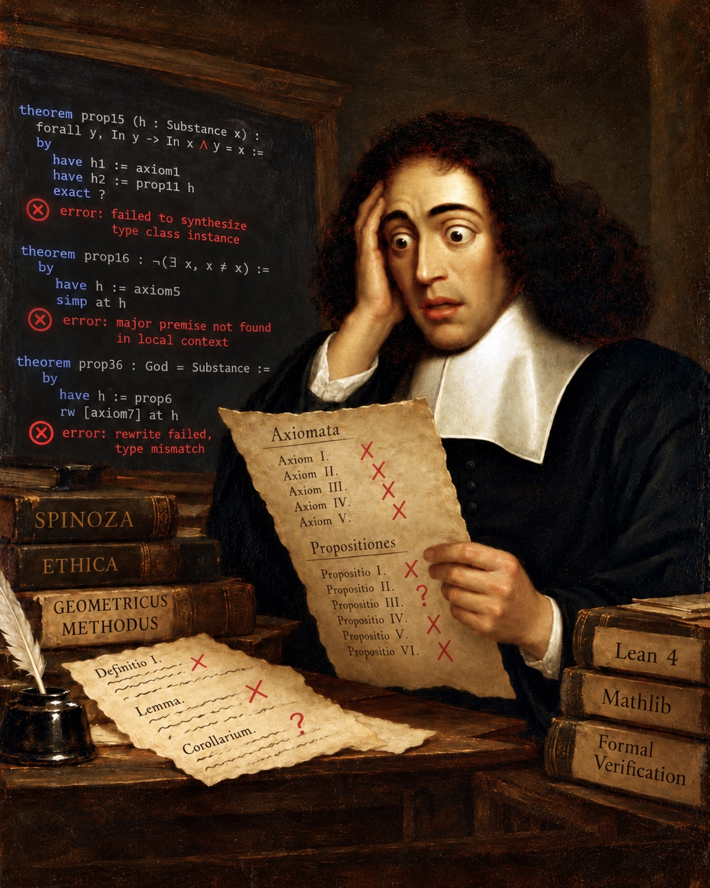

# lean-countermodel

<p align="center">
  
  <br>
  <em>Spinoza's theorem-proving crisis.</em>
</p>

**Kernel-checked finite counter-models for Lean 4, found by Vampire.**

**Authors:** Michael Jagdeo, Exponent Labs LLC · Jeff Dumps. **Whitepaper:** [`paper/whitepaper.pdf`](paper/whitepaper.pdf) ([Markdown](paper/whitepaper.md)) covers the method, data structures, scaling recipe, evaluation and related work. Working on the code with an AI agent? See [`AGENTS.md`](AGENTS.md).


**Contents:** notes to [Nakamura](#a-note-to-yuki-nakamura), [the Lean community](#a-note-to-the-lean-community) and [the Vampire team](#a-note-to-the-vampire-team); four short sections for anyone ([the question](#where-this-started-does-spinozas-argument-go-through), [Spinoza](#spinozas-ethics-a-theory-of-everything-built-like-geometry), [Nakamura](#nakamuras-lean-project-checking-spinoza-with-a-proof-checker), [what we built](#what-we-built-and-why-it-matters)), then the technical README: [quick start](#0-quick-start), [results](#1-results-at-a-glance), [method](#3-method), [case studies](#4-case-studies), [trust](#5-why-trust-it), [limits](#6-limits), [reproduce](#7-reproduce).

## A note to Yuki Nakamura

Thank you. Your [spinoza-ethica-lean](https://github.com/Nakammura/spinoza-ethica-lean) is where this project started: its register of every assumption, and its honesty about open gaps, made it possible to ask a machine precise questions.

What we did with it, at commit 6d4c046:
- **Transcribed** your `Definitions.lean` and `Axioms.lean` into first-order TPTP, each line citing its Lean source (`examples/nakamura_a12.p`, `examples/nakamura_a15.p`). We checked the transcription first by reproducing your **positive** results.
- **Found** counter-models for S-A12 and S-A15 automatically, with 2 elements each, in about 0.1 s.
- **Certified them against your library, unmodified.** `nakamura/` compiles each model into instances of your `EthicaWorld` and `StatedAxioms` classes, and `#print axioms` reports only `propext`.
- **Mapped** which register axioms each conclusion needs (`ablation/`).

The models are smaller partly because one object is both a substance and an attribute, which your register permits. We touched only the first-order layer, not the S5 modal one. If anything here misrepresents your formalization, we'd be grateful to hear it: please open an issue.

## A note to the Lean community

Lean 4 can import *proofs* from automated provers. This project adds the converse: **kernel-checked counter-models**, showing that a claim does *not* follow from a set of axioms.

What you get:
- **Certificates use only Lean's standard axioms.** They use `decide` (shallow) or `decide +kernel` (reflected); `cm.py` never emits `native_decide`, and the benchmark reports the few results that needed it separately.
- **A verified checker.** `Checker.lean` proves, once, that its evaluator agrees with ordinary first-order satisfaction (`sem_iff_sat`).
- **No package dependencies.** It runs on Lean 4.35.0 alone.

What we learned about the kernel at scale is in the whitepaper, §5:
- certifying a million facts in a median of 5.2 minutes;
- a failure band near 20,600 declarations per file on Lean 4.13;
- three verdicts that improved between Lean 4.13 and 4.35.

The obvious next step is a Lean command or tactic front end, so users never write TPTP by hand. Contributions and design advice are welcome.

## A note to the Vampire team

Thank you for Vampire. Its finite-model builder does all the searching here: `vampire -sa fmb -updr off`, version 5.1.0.

This work is the converse of [vamplean](https://github.com/vprover/vamplean) (Bodingbauer et al., ITP 2026): they bring Vampire's *proofs* into Lean, and we bring its *models*. Vampire is treated as untrusted: only Lean's kernel decides whether a model becomes a certificate, and a wrong model never does.

What Vampire found:
- **The three TPTP samples:** within 30 s per problem, finite models for 78, 62 and 67 of 100 problems.
- **Spinoza:** both 2-element models in about 0.1 s.
- **NLP263+1:** a model for over a million facts.

How we read Vampire's answers, for anyone building on it:
- We parse the finite-model output (`cm.model`).
- We classify each answer by its SZS status and termination reason (`cm.classify`). A 5.1 time limit exits with status 1 and no SZS status, so we read the termination reason.

If either format changes, those two functions are the only places to update. Feedback is welcome.

## Where this started: does Spinoza's argument go through?

In 1677 Baruch Spinoza argued that exactly one substance exists: God, or Nature. One step carries much of the weight, *Ethics* I, Proposition 5: **no two substances can share an attribute.** Readers have argued over that step for three and a half centuries:

| Who | Position |
|---|---|
| **Spinoza, 1677** | "There cannot exist in the universe two or more substances having the same nature or attribute." (Elwes translation) |
| **Bennett** | The demonstration does not establish the full conclusion from the resources Spinoza provides: two substances could share one attribute and differ in another. |
| **Della Rocca** | The Principle of Sufficient Reason can supply the missing route: distinct things must differ for a reason. |
| **Nakamura, 2026** | Write the commitments as Lean code and let a proof checker decide what follows from what. |

Nakamura's answer: a weak version of Proposition 5 follows; the strong version does not, from the assumptions tested. The evidence is two **counter-models**, small invented worlds in which every assumption is true and the claim is false, **built by hand**, with 4 and 3 objects.

**This project began with one question: could a machine find those worlds on its own, and could Lean certify what it found?** It could. Vampire, an automated prover, found both in about a tenth of a second, each with only 2 objects, and Lean checked them against Nakamura's own unmodified code.

## Spinoza's *Ethics*: a theory of everything, built like geometry

Spinoza's *Ethics* tries to explain everything, from God to human happiness, and it does so the way Euclid explained geometry: its full title is *Ethics, demonstrated in geometrical order.*

- **What it claims.** Exactly one thing exists on its own: call it God, or Nature. Everything else (people, planets, thoughts) exists in it, as a way it is. From there the book works out what a mind is, where emotions come from, and how a person can live freely.
- **How it argues.** First define the terms. Then state axioms, assumptions taken as obvious. Then prove propositions one at a time, each proof citing the definitions, axioms and earlier propositions it uses.
- **Why that invites a machine.** An argument laid out as definitions, axioms and proofs can be checked step by step: does this proposition really follow from what it cites? That question, disputed for centuries, is one software can now answer precisely.

## Nakamura's Lean project: checking Spinoza with a proof checker

In 2026 Yuki Nakamura translated the core of *Ethics* Part I into Lean 4 ([repository](https://github.com/Nakammura/spinoza-ethica-lean) · [paper, arXiv:2605.02331](https://arxiv.org/abs/2605.02331)). Every Spinoza result here builds on it.

- **What Lean is.** A programming language for writing proofs. You state a claim and its proof as code, and a small, carefully trusted part of Lean, the *kernel*, checks every step. If it accepts, no step was skipped or hand-waved. Mathematicians use it to check research mathematics.
- **What Nakamura built.** Spinoza's definitions and axioms for Part I as Lean code, with the propositions that carry the argument (II to XIV) proved from them. Every assumption added beyond Spinoza's text is listed in a register, and any step left unproven is listed openly as a gap.
- **What it found.** The weak Proposition 5 can be proved: substances with exactly the same attributes are the same substance. The strong one cannot, from the assumptions tested, and two hand-built counter-models show it.

Building such worlds by hand is slow, and it doesn't scale to every step of every argument. That is the gap this project fills.

## What we built, and why it matters

**Proving that something does *not* follow is half of reasoning, and Lean had no general way to automate it.** Lean can import *proofs* from automated provers. But to show that assumptions do **not** imply a claim, you must exhibit a world where they hold and the claim fails, and Lean projects still build those by hand. Isabelle has had an automatic finder for them (Nitpick) since 2010.

**lean-countermodel closes that gap for any first-order theory.** Our first pass on Spinoza used two automated provers, Z3 and Vampire. They found counter-models in milliseconds, but trust rested on the two provers agreeing. The tool splits the work: **Vampire searches, Lean certifies.** Vampire is never trusted; if it returns a wrong model, Lean rejects it and no certificate is produced.

**What it achieved:**
- **Spinoza:** both of Nakamura's negative results, reproduced automatically with **2-object worlds** (against 4 and 3 by hand), certified against Nakamura's own library.
- **Beyond philosophy:** on 300 problems drawn from TPTP, the standard library of problems for automated reasoning, Lean certified 185 counter-models under a strict kernel-only policy, including **59 of the 67 models found on a sample chosen before it was first run**.
- **At scale:** a problem with over **a million facts**, certified in a median of **5.2 minutes** on an 8 GB laptop.
- **Under review:** the code, results and paper went through repeated rounds of independent artifact review, which found real defects, all fixed and documented in the [whitepaper](paper/whitepaper.pdf).

**Why it matters beyond Spinoza:** any argument that can be written as definitions and axioms, in mathematics, philosophy, law or software specifications, can now be tested for hidden assumptions. When a step doesn't follow, the tool hands back a concrete, machine-checked world that shows why.

**What it does not claim:** every result is about a formalization, not Spinoza's text itself; whether a formalization is the right reading is interpretation, where the machine stops. A counter-model shows a claim does not follow; it does not show the claim is false.

---

**In technical terms:**

> To show that some axioms do **not** imply a claim, you exhibit a world where the axioms hold and the claim fails.
> Vampire finds such a world automatically. `cm.py` turns it into a Lean 4 certificate, and Lean's kernel checks it.
> Vampire is untrusted: a model that is ill-formed or falsifies the encoded problem yields no certificate.
> The translation from TPTP into Lean is trusted code, tested against an independent evaluator of the original formulas.

```
python3 cm.py examples/group_comm.p > G.lean && lake env lean G.lean             # one theorem per formula
python3 cm.py --reflect examples/group_comm.p > G.lean && lake env lean G.lean   # through the verified checker
```

## 0. Quick start

**You need:**
- macOS or Linux (we test on macOS 14.4 on Apple Silicon; the peer reviewer ran everything on Ubuntu 24.04 x86-64);
- [elan](https://github.com/leanprover/elan), the Lean version manager. `lean-toolchain` pins Lean 4.35.0, and elan fetches it on first use;
- Python 3.12 or later, with pytest;
- the [Vampire 5.1.0](https://github.com/vprover/vampire/releases/tag/v5.1.0) binary for your platform.

```sh
git clone https://github.com/exponentlabshq/lean-countermodel && cd lean-countermodel
curl https://raw.githubusercontent.com/leanprover/elan/master/elan-init.sh -sSf | sh   # only if you have no elan
python3 -m pip install -r requirements.txt
export VAMPIRE=/path/to/vampire          # or put the binary on your PATH as `vampire`

lake build                               # the checker and the 30 shipped certificates; no network after the toolchain
python3 cm.py examples/group_comm.p > G.lean && lake env lean G.lean   # no output and exit 0: Lean accepted it
python3 -m pytest test_cm.py -q          # a fresh clone: 168 passed, 2 skipped
./recheck.sh                             # every shipped certificate's axioms, and a fresh kernel replay; exit 0
```

**What to expect:**
- **The two skipped tests** need data that isn't in the repository: the TPTP benchmark inputs (rebuilt by `bench/inputs.py`, §7) and a Vampire answer cache. With both present, all 170 pass.
- **Without Vampire,** the tests that need no Vampire model still run: 80 in a fresh clone, 82 with the benchmark data present.
- **To see what a certificate depends on,** append `#print axioms group_comm.countermodel` to `G.lean`. A shallow certificate depends on at most `propext`; a reflected one (`cm.py --reflect`) on `propext` and `Quot.sound`.

**Using it on your own problem:** write it in TPTP `fof` or `cnf` (§6 and the whitepaper's §8.1 list what is supported), then:

```sh
python3 cm.py problem.p > P.lean && lake env lean P.lean             # one theorem per formula
python3 cm.py --reflect problem.p > P.lean && lake env lean P.lean   # through the verified checker
python3 cm.py --reflect problem.p OUTDIR                             # a large problem: Lean modules in OUTDIR/<name>/
```

**Environment variables:**

| Variable | Meaning | Default |
|---|---|---|
| `VAMPIRE` | path to the Vampire binary | `vampire` on your PATH |
| `CM_CACHE` | a directory where Vampire's answers are cached by content; only definite answers are stored | no cache |
| `CM_CHUNK` | formulas per Lean module above which the shallow emitter writes modules | 2000 |
| `TPTP` | an unpacked TPTP release that the benchmark harness reads problems from | the TPTP website |

`cm.py` exits non-zero, with a message, when Vampire finds no finite model, when the input uses a TPTP feature it does not support, or when Vampire fails to run. It never writes a certificate for a problem it has not read completely.

---

## 1. Results at a glance

| Claim | Evidence |
|---|---|
| **Works on independent problems** | Three samples of 100 TPTP problems with status Satisfiable or CounterSatisfiable, inputs rebuilt from the official TPTP release, all rerun at one commit after the round-4 repair. On the **third sample, selected before its first execution**, Vampire found 67 finite models and **59 were certified under a strict kernel-only policy (88.1%)**; 3 more use `native_decide` (a larger trusted base). Development: 71 of 78 (91.0%); second sample: 55 of 62 (88.7%). Descriptive results; see §4.1. |
| **Scales to a million facts** | NLP263+1 (1,026,857 facts, 383,180 constants) is certified in a median **5.2 min** through the verified checker, against 14.1 min one-theorem-per-formula, in a controlled, repeated comparison on an 8 GB laptop |
| **Beats hand construction on a published Lean project** | It reproduces both of Nakamura's hand-built Spinoza counter-models from their axioms alone, with **2-element** models against their 4 and 3, checked against their own library (§4.2) |
| **Proved semantics** | `Checker.lean` proves, once, that for a valid model (non-empty domain, closed functions) and closed, well-formed formulas, its evaluator agrees with **ordinary first-order satisfaction** on `Fin n`. Reflected certificates conclude exactly that, using only Lean's standard axioms (`propext`, `Quot.sound`). |
| **Tested like it matters** | 170 tests: an independent evaluator of the original formulas, corrupted models, rewrite equivalence, kernel-checked boundary cases (empty domain, out-of-range constants, malformed data), rejection of unsupported syntax, variable capture, include expansion, and benchmark inputs checked byte for byte against the official TPTP release; `recheck.sh` replays every shipped certificate with `leanchecker --fresh`, and `bench/replay.py` every strict benchmark certificate |

## 2. The gap

| Capability | Elsewhere | Lean 4 |
|---|---|---|
| Import proofs from automated provers | Isabelle: Sledgehammer | Lean-auto, LeanHammer, Duper; Vampire proof reconstruction [3] |
| Find concrete counterexamples in fixed types | Isabelle: Quickcheck | `plausible`, Lean Disprove [6] |
| **Find a new finite structure that refutes a claim from abstract axioms, and certify it** | Isabelle: **Nitpick** [5]; HOL4: **HolRefute** [4] (certified replay; unmerged as of Oct 2026); Coq: Goubault-Larrecq's finite models with Coq-checkable proofs, for security-protocol clause sets [7] | **No general automated front end found.** The Equational Theories Project [2] built project-specific machinery for magma laws; other projects build models by hand [1, §4.4] |

This project is a general tool for that last row: any first-order theory in TPTP. It is the converse of [3]: Bodingbauer et al. bring Vampire's *proofs* into Lean; we bring its *models*.

## 3. Method

A problem passes through six phases (`cm.py`, then Lean). Only one tool is trusted to decide the result: Lean's kernel.

| Phase | Purpose | Inputs | Processes & Stack | Output | Trusted |
|---|---|---|---|---|---|
| **1. Find** | Find a candidate world where the axioms hold and the claim fails | A self-contained TPTP file (`fof`/`cnf`) | **Vampire 5.1.0** searches for a finite model of `axioms ∧ ¬conjecture` (`-sa fmb -updr off`, 30 s). `cm.classify` sorts the answer into model, definite non-model, resource limit or finder error; only definite answers are cached, by content (`CM_CACHE`) | A finite model (domain size, constant values, function and predicate tables), or *no model* / *finder error* | **No**: a wrong model yields no certificate |
| **2. Read** | Get every formula of the problem, exactly | The same TPTP file | **Python 3.12**, standard library only: `cm.statements` accounts for every character, or rejects the file with a line number. Unsupported features (and `include`, which the benchmark harness expands first) are rejected, never misread | Records: name, role, formula | **Yes**, tested against an independently written reader |
| **3. Rewrite** | Make formulas cheap to check without changing their meaning | The records | **Python** (`cm.problem`): miniscoping, flattening, greedy literal order | The encoded problem: the axioms and the negated conjecture | **Yes**, validated against the original formulas on bounded models |
| **4. Compile** | State the result as a Lean theorem | The model and the encoded problem | **Python**: `cm.emit` writes **shallow** certificates (an `inductive T`, bitmask tables, one theorem per formula); `cm.emit_reflect` writes **reflected** ones (problem and model as packed data). Large problems are split into modules | A `.lean` file, or modules, ending in `theorem countermodel` | **Yes**, the translation; tested independently |
| **5. Certify** | Decide the result with a small trusted checker | The Lean file | **Lean 4.35.0** kernel (via elan; no package dependencies). Shallow: `decide` per formula. Reflected: `valid` and `Good M fns problem` by `decide +kernel`, giving ordinary first-order satisfaction through `Checker.lean`'s `sem_iff_sat`, proved once. `#eval problem` prints exactly what is certified | An accepted theorem (exit 0), or a rejection | **The trusted base**: certificates use only `propext` and `Quot.sound` |
| **6. Audit** | Catch errors in the trusted Python | Original files, models, certificates | **pytest** (170 tests, with the independent oracle in `test_cm.py`); `leanchecker --fresh` (`recheck.sh`, `bench/replay.py`); `bench/fidelity.py`; `bench/negative-controls.sh` | Test log, replay and fidelity ledgers, coverage report | Checks, not part of a certificate |

**Around the pipeline:**
- **Benchmark inputs:** the official TPTP v9.3.1 release, verified byte for byte (`bench/inputs.py`).
- **Spinoza case study:** Z3 validated the transcription against Nakamura's positive results, and Nakamura's own Lean 4.13 library checks the counter-models (`nakamura/`).
- **Whitepaper:** pandoc and Tectonic (`paper/assemble.py`).

**Hybrid dispatch:** reflection wins on ground facts: 3.2× less CPU on a 10,000-fact slice and 2.6× on the million-fact problem, in the controlled comparison of §4.3. One theorem per formula still wins on deeply nested quantifiers. The benchmark uses reflection when at least 90% of formulas are ground facts. Details, the measured design patterns and the negative results are in the whitepaper, §4–5.

## 4. Case studies

### 4.1 TPTP: three samples of 100 problems

From TPTP's ProblemAndSolutionStatistics we kept the **2,561** fof/cnf problems marked Satisfiable or CounterSatisfiable (`bench/eligible.tsv`); these statuses do not guarantee a *finite* model. Every input is rebuilt byte for byte from the official TPTP v9.3.1 release (`bench/inputs.py`, `bench/inputs.json`). Three samples:

- **Development** (100): not uniform (the first 20 came from a domain-first picker), and used to find and fix bugs.
- **Second sample** (100, uniform, seed 20261015): initially held out, then used to diagnose and repair defects. Descriptive, not an untouched test.
- **Third sample** (100, uniform, seed 20261016): selected before its first execution. A harness-only change after an aborted attempt recorded translator exceptions as failures (whitepaper §6.2.1).

After the round-4 repair (below), all three samples were rerun at commit `66c8b32`, so all three have now been exposed to development and the results are descriptive. That rerun had a background process of ours occupying one CPU core; strict totals were unchanged.

| Outcome (all at `66c8b32`) | Development | Second | **Third** |
|---|---|---|---|
| Unsupported input (rejected, never misread) | 3 | 4 | 3 |
| Translator crash (one before, one after a model was found) | 0 | 0 | 2 |
| Vampire found no model (30 s) | 19 | 34 | 29 |
| Models found | 78 | 62 | 67 |
| **Certified, strict kernel only** | **71 (91.0% of models)** | **55 (88.7%)** | **59 (88.1%)** |
| Certified with `native_decide` | 2 | 2 | 3 |
| Lean rejected (time or instance-search limits) | 5 | 5 | 4 |
| Full pipeline, strict, of all 100 | 71% | 55% | 59% |

- **Given a model, strict certification rates are similar across the samples;** full-pipeline success varies mainly with how many models Vampire finds in 30 s.
- **Uncertified candidates produced no certificate.** Most rejections are deeply nested formulas that exhaust Lean's instance search; the rest exceed the 60 s limit. The third sample also exposed two translator crashes (`KRS290-1`: recursion depth; `SYO595-1`: a >2,000-formula problem on the benchmark's shallow path), reported as failures.
- **Rebuilding the inputs from the release found a defect:** the old expander also expanded includes inside comments, which had changed `RNG025-9` and `BOO008-3`. Two benchmark no-model-found outcomes concerned altered inputs and are superseded; on their correct inputs both are certified.
- **Round-4 artifact audit: record omission.** The record reader could skip a legal TPTP record without error. **Eight earlier certificates omitted source premises and were withdrawn. The repaired pipeline subsequently certified their complete source problems. Unchanged strict totals do not validate the superseded certificates.** One previously native-assisted result (`ALG310-1`) timed out in the rerun and is reported as a failure. Records are now read totally and fail-closed, the oracle reads them independently, and every certified result was checked against its original source file: 189 of 192 are faithful, and 3 remain unchecked and are named (`bench/coverage.md`). All 185 strict certificates passed `leanchecker --fresh`.
- Superseded runs, kept for the record: `bench/superseded-*.jsonl` (whitepaper §6.2.1).
- **Three verdicts improved between Lean 4.13 and 4.35 during development:**
  - NLP263+1 (§4.3);
  - HWV048-2, a stack overflow on 4.13, now certified in 2.7 s;
  - NLP018-10, now kernel-only.

### 4.2 Spinoza's *Ethics*: Nakamura's Lean formalization [1]

**The question.** Nakamura formalizes *Ethics* I in Lean 4. Nakamura's *demote experiments* ask whether a contested axiom of Spinoza's follows from a weaker principle. Two of their published answers are negative:

- **S-A12:** A12 (an attribute belongs to one substance) does not follow from their `StatedAxioms` plus `PSRSubstance`, a principle of sufficient reason requiring distinct substances to differ in some attribute.
- **S-A15:** A15 (every attribute of a substance is an attribute of God) does not follow from `StatedAxioms` plus plenitude.

Nakamura proves both with counter-models built **by hand** ([1] §4.4), with 4 and 3 elements. We asked whether the tool could find them on its own.

**How we got the result.**

| Step | What we did | Check |
|---|---|---|
| 1. Read | Nakamura's `Definitions.lean`: 13 primitive predicates (`inItself`, `perSeConceived`, `intellectPerceivesAsEssence`, …) and the defined `Substance`, `Attribute` and `IsGod`. Nakamura's `Axioms.lean`: the 12 `StatedAxioms` fields, 4 of which are `True` placeholders. Nakamura's sufficient-reason classes. All at commit 6d4c046. | — |
| 2. Transcribe | Into first-order logic: primitives → predicates; `def`s → biconditionals; the 8 nontrivial fields of their `StatedAxioms` register (12 fields, 4 of them `True` placeholders; the 8 mix stated axioms with their bridges A8–A11) → axioms; the weaker principle Σ → axiom; the target → conjecture. See `examples/nakamura_a12.p`. | Each line cites its Lean source |
| 3. Validate | The transcription must reproduce their **positive** results before its negative ones mean anything | It does: weak P5 follows from StatedAxioms + `PSRSubstance`, and A15 from StatedAxioms + A25 + A26 (Z3, unsat cores) |
| 4. Search, blind | `vampire -sa fmb` on each problem. The encoding came from their definitions and axioms only; we had read their `A15CounterModel` earlier, but not their `A12CounterModel`, and the search is automatic either way. | 2-element models in about 0.1 s. Z3 failed on S-A12. |
| 5a. Certify (transcription) | `cm.py` compiles the model; `decide` proves `axioms ∧ ¬conjecture` | `Cm/nakamura_a12.lean`, `Cm/nakamura_a15.lean` |
| 5b. Certify (**their library**) | The same models are compiled into instances of **their own classes**: a finite `T`, `instance : EthicaWorld T` (13 tables), and `instance : StatedAxioms T` (every field by `decide`). Then `theorem result : StatedAxioms T ∧ Σ ∧ ¬A`. | `nakamura/`: builds against a fresh clone of their unmodified library; `#print axioms` gives `[propext]` |

**The models**, with `attribute(a, s)` meaning "a is an attribute of s":

| | Universe | Substances | Attribute relation | Why the target fails |
|---|---|---|---|---|
| **S-A12** | {1, 2} | both | 1 is an attribute of 1; 2 is an attribute of 1 and of 2 | The two substances **share** attribute 2, so A12 fails. They also **differ** in attribute 1, so the sufficient-reason principle still holds. This is the shape of the classic objection to I P5: substances sharing one attribute and differing in another. |
| **S-A15** | {1, 2} | both, and **both are gods** | 1 is an attribute of 1 and 2; 2 is an attribute of 2 only | Attribute 2 belongs to a substance, but not to god 1, so A15 fails. Plenitude holds, since every substance is itself a god. Two gods, as in their model. |

**Results.**

| Claim | Nakamura's model (by hand) | Ours (automatic) |
|---|---|---|
| S-A12 | 4 elements | **2 elements**, 0.1 s |
| S-A15 | 3 elements | **2 elements**, 0.1 s |

**Caveat on "smaller".** In our models the same objects are both substances and attributes. Nakamura's axioms permit that: attributes are conceived through themselves, and so they count as substances under their definitions. But it is part of why the models are smaller. A sorted encoding that kept substances and attributes apart would test whether 2 elements still suffice.

**Further results in the same framework** (found earlier in this project, with an LLM proposing candidate premises and provers screening them; the counter-models were first written by hand and are now generated by `cm.py`):

| Example | Claim |
|---|---|
| `p14_bridge_weaker` | The P14 bridge H ("every substance shares an attribute with God"), with A14 and a unique god, does not give A15 |
| `p7_needs_a4c`, `p7_needs_b1c`, `p7_needs_b1` | *Ethics* II P7 (the order of ideas is the order of things) needs each of its bridges: the converse of I A4, and two idea–thing bridges |


### 4.3 One million facts: NLP263+1

Controlled comparison: Lean 4.35, 4 workers for both methods, 3 alternating clean builds each, idle 8 GB M2 laptop (`bench/perf.py`, `bench/perf.jsonl`). Median (range):

| | One theorem per formula | **Verified checker** |
|---|---|---|
| Wall time | 14.1 min (12.6–17.2) | **5.2 min (5.2–5.8)** |
| CPU time | 52.5 min | **20.3 min** |
| Peak memory, largest process | 1.42 GB | **0.50 GB** |
| Peak memory, all Lean processes | 2.67 GB | **1.86 GB** |
| Statement | 1,026,857 propositions | ordinary first-order satisfaction in the model (§4.4) |

The model has one element, so this measures certificate throughput, not combinatorial checking.

This problem forced most of the scaling recipe. On the way it exposed four bugs:
- `%` inside a quoted name was read as a comment;
- a kernel overflow on a 10,000-long conjunction;
- a limit of about 20,600 declarations per file in Lean 4.13;
- a quoted constant `'T'` that could clash with internal names.

## 5. Why trust it

| Check | What it guarantees |
|---|---|
| Lean's kernel | The model satisfies the *stated* formulas |
| An independent Python evaluator | The same verdicts by brute force, independently of any translation into Lean |
| Mutants (one corrupted table entry at a time) | Lean accepts exactly what the evaluator accepts, on both certificate paths |
| Rewrite equivalence | Each rewritten formula agrees with its original on every model and mutant |
| Total record reading | The whole file is accounted for, or it is rejected with a line number: a record can't be dropped silently. The test oracle reads records with its own, separately written reader |
| Source fidelity | For 189 of the 192 certified benchmark results, the oracle read the **original** file and confirmed every formula in the certified model (`bench/coverage.md`; 3 are unchecked and named, none failed) |
| Fresh kernel replay | All 30 shipped certificates (`recheck.sh`) and all 185 strict benchmark certificates (`bench/replay.py`) replay from scratch with `leanchecker --fresh`, using only Lean's standard axioms |
| Negative controls | `bench/negative-controls.sh` checks that each safeguard fails when it should: a wrong model, a crashing finder, a certificate using `sorry`, a missing build tool, an altered input byte |
| Planted bugs | Each one fails tests: a translation error, a scoping error, a dropped negation, a lost parenthesis, a single-formula edge case |

**Lessons from real bugs:**
- **A flattening rule** misread TPTP's `! [X] : A => B` as ∀X (A → B). On three problems, Lean certified a *different statement*.
- **The record reader** once skipped records it couldn't match, so eight certificates checked weakened problems. They were withdrawn, and the repaired pipeline certified the complete problems.

Each bug was fixed, regression-tested, and every problem rerun. **What you read and rewrite is part of what you must trust:** Lean proves exactly the statement it is given.

## 6. Limits

- **No command inside Lean yet;** you write TPTP.
- **Untyped first-order logic only;** unsupported TPTP features are rejected, never misread (whitepaper §8.1 lists them).
- **Reflected checking of deeply nested quantifiers is slow,** so the benchmark dispatches by fact share.
- **Vampire's limits are ours:** within 30 s, no model for 19, 34 and 29 of the three samples' 100 problems. Some have no finite model at all.
- **The TPTP-to-Lean translation is trusted, tested code, not a verified compiler.** Rewriting is checked by bounded validation, not proved equivalent.
- **Source fidelity is checked for 189 of 192 certified results;** `NLP219-1`, `NLP179+1` and `NLP186+1` are unchecked. Native-assisted results (7) trust Lean's compiler and are not replayed.
- **Known crash classes**, reported as failures: very deep formula nesting exceeds Python's recursion limit (`KRS290-1`), and the benchmark harness does not handle shallow certificates of more than 2,000 formulas (`SYO595-1`).
- **`bench/perf.py` is macOS/BSD-specific.** It reads memory through `/usr/bin/time -l`.

## 7. Reproduce

| | |
|---|---|
| Requirements | See §0. `nakamura/` pins Lean 4.13; the main project has no Lean package dependencies |
| Vampire | One binary from the v5.1.0 release, for example `gh release download v5.1.0 -R vprover/vampire -p vampire-macOS-ARM64.zip && unzip vampire-macOS-ARM64.zip` (other platforms have their own assets) |
| Tests | `lake build && python3 -m pytest test_cm.py` (170 tests: 168 pass and 2 skip in a fresh clone; without Vampire, 80 run in a fresh clone and 82 with the benchmark data), including `tests/Boundary.lean`; `./recheck.sh` for axioms and a fresh kernel replay; `bench/negative-controls.sh [TPTP-v9.3.1]` for the failure controls |
| Examples | `lake build`, then `lake env lean Axioms.lean` |
| Nakamura | `cd nakamura && lake build && lake env lean Axioms.lean` (clones spinoza-ethica-lean @ 6d4c046, about 11 MB) |
| Benchmark inputs | Download and unpack the official [TPTP v9.3.1 release](https://tptp.org/TPTP/Distribution/TPTP-v9.3.1.tgz) (934 MB; about 10 GB unpacked), then `python3 bench/inputs.py verify TPTP-v9.3.1 TPTP-v9.3.1.tgz`. It rebuilds every input and checks every file, and the tarball, against `bench/inputs.json` |
| Benchmark | Frozen runs: `bench/frozen.py`, then `bench/replay.py` (usage in each file; about 40 and 45 minutes); exploratory sampling: `python3 bench.py N [WORKERS]` |
| Source fidelity and coverage | `bench/fidelity.py`, `bench/rewrite_check.py`, then `bench/coverage.py` (each takes the `bench` directory); the report is `bench/coverage.md` |
| Ablation | `python3 ablate.py ablation/nakamura_register.p OUTDIR`: the assumption-dependency map, with certified counter-models (about 2 minutes) |
| Whitepaper | `python3 paper/assemble.py` builds `paper/whitepaper.md` from `paper/whitepaper/` |
| Formal-philosophy agenda | `paper/philosophy-lean-vampire-research.md` (original) and `paper/formal-philosophy.md` (revised, with results) |

## License

MIT; see [`LICENSE`](LICENSE). Third-party material keeps its own terms:
- **TPTP:** `bench/slice10000.p` is a slice of TPTP problem NLP263+1, and the benchmark rebuilds its inputs from the TPTP release; please cite TPTP when you use them.
- **Nakamura:** `nakamura/` builds against Nakamura's MIT-licensed [spinoza-ethica-lean](https://github.com/Nakammura/spinoza-ethica-lean), which it clones and does not include; `examples/nakamura_*.p` and `ablation/nakamura_register.p` transcribe its definitions and axioms, with citations.
- **Vampire** is not included; it is distributed under its own license.

## References

1. Y. Nakamura. *Bennett's Conjecture in Lean 4: Counter-Models for the PSR-Reducibility of Spinoza's Propositions V and XIV.* arXiv:2605.02331, 2026. [github.com/Nakammura/spinoza-ethica-lean](https://github.com/Nakammura/spinoza-ethica-lean)
2. M. Bolan et al. *The Equational Theories Project: Advancing Collaborative Mathematical Research at Scale.* arXiv:2512.07087. [teorth.github.io/equational_theories](https://teorth.github.io/equational_theories/paper.pdf)
3. J. Bodingbauer, M. Hajdu, L. Kovács, A. Polaczek, M. Rawson. *Lean on Vampire Proofs (Short Paper).* ITP 2026, LIPIcs 382, 36:1–36:9. DOI 10.4230/LIPIcs.ITP.2026.36. [github.com/vprover/vamplean](https://github.com/vprover/vamplean)
4. HolRefute: HOL-Theorem-Prover/HOL pull request #2051. [github.com/HOL-Theorem-Prover/HOL/pull/2051](https://github.com/HOL-Theorem-Prover/HOL/pull/2051)
5. J. C. Blanchette, T. Nipkow. *Nitpick: A Counterexample Generator for Higher-Order Logic Based on a Relational Model Finder.* ITP 2010.
6. J. Ondras, C. Freer. *Lean Disprove: Certified Counterexample Search for AI-Assisted Formal Mathematics.* ICML 2026 AI-for-Math workshop.

7. J. Goubault-Larrecq. *Finite Models for Formal Security Proofs.* Journal of Computer Security 18(6): 1247–1299, 2010. DOI 10.3233/JCS-2009-0395.

The full reference list (35 entries, each marked verified or partly verified) is in the whitepaper.
