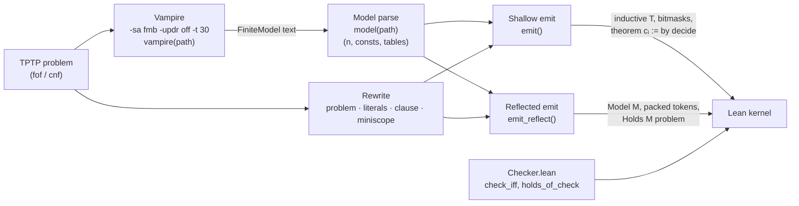

# Lean on Vampire *Models*

### Kernel-Checked Finite Counter-Models for Lean 4: a Verified Reflective Checker, a Measured Scaling Recipe, and a Million-Fact Certificate

**Michael Jagdeo**, Exponent Labs LLC · **Jeff Dumps**

*Whitepaper, October 2026. Code and data: https://github.com/exponentlabshq/lean-countermodel*

---

## Abstract

To show that axioms do **not** imply a claim, one exhibits a structure in which the axioms hold and the claim fails. Isabelle has had a finder for such counter-models for over fifteen years. Lean 4 can import *proofs* from automated provers and search for concrete counterexamples in fixed types. It has no general way to obtain *counter-models* of abstract first-order theories, so projects build them by hand.

We present `lean-countermodel`, which turns finite models found by the Vampire prover into certificates checked by Lean's kernel. Vampire is never trusted: a wrong model fails the check. Certificates take two forms:

- **Shallow:** the model as a Lean inductive type, with one theorem per formula.
- **Reflected:** a 215-line Lean library defines first-order formulas as data, gives them Tarski semantics, and proves a Boolean evaluator sound and complete once. A certificate is then a single statement, `Holds M problem`, proved by kernel evaluation of packed data. It uses only Lean's standard axioms, and `#eval` prints exactly what it certifies.

The work is mostly about making the check finish. Naive certificates are hopeless at scale: one benchmark clause has about 10¹¹ cases, and a 10,000-formula file overflows Lean's kernel. We give a measured recipe of classic patterns, among them backtracking via miniscoping, greedy join ordering, bitsets, balanced trees, hierarchical aggregation, content-addressed caching, blocking and reflection. Each pattern is kept or rejected on measurement, and the negative results are reported. The central lesson for anyone generating large Lean certificates is that **the cost is elaborating statements, not evaluating them.**

**Evaluation:**
- **A uniform sample of TPTP.** On 100 problems drawn from the 2,561 TPTP problems with a finite-model status, Lean certifies **72 of the 77 models Vampire finds (94%), 70 of them with the kernel alone**, and none of the failures is a wrong model.
- **A million-fact problem.** NLP263+1 has 1,026,857 facts and 383,180 constants. Its certificate takes 20.7 minutes as a shallow certificate and **4.8 minutes reflected**, on an 8 GB laptop.
- **A published Lean formalization.** The tool reproduces, from axioms alone, both hand-built counter-models in Nakamura's Lean formalization of Spinoza's *Ethics*, with smaller models.

**Keywords:** Lean 4 · finite model finding · counter-models · Vampire · TPTP · proof by reflection · certificates · interactive theorem proving

---

## Contents

1. [Introduction](#1-introduction)
2. [Background and Problem](#2-background-and-problem)
3. [Method: Find, Rewrite, Compile, Certify](#3-method-find-rewrite-compile-certify)
4. [The Verified Checker: Data Structures and Trust](#4-the-verified-checker-data-structures-and-trust)
5. [Scaling: Design Patterns, Data Structures and Measured Effects](#5-scaling-design-patterns-data-structures-and-measured-effects)
6. [Evaluation and Case Studies](#6-evaluation-and-case-studies)
7. [Related Work](#7-related-work)
8. [Limitations and Future Work](#8-limitations-and-future-work)
9. [Conclusion](#9-conclusion)
- [Appendix A: Reproducing Every Number](#appendix-a-reproducing-every-number)
- [References](#references)

### List of tables and figures
- Figure: 3.1 Pipeline
- Table: 3.3 Model parse: `model(path)`
- Table: 3.4 Rewrite: `problem`, `literals`, `clause`, `miniscope`
- Figure: 3.4 Rewrite: `problem`, `literals`, `clause`, `miniscope`
- Table: 3.5 Compile (shallow): `emit`
- Table: 3.8 Trust boundary
- Figure: 3.9 Worked example: `transitive_cnf`
- Table: 3.9 Worked example: `transitive_cnf`
- Table: 3.10 Independent checks (`test_cm.py`)
- Table: 4.1 Data structures
- Table: 4.2 Models in generated certificates
- Table: 4.3 Problem encodings
- Figure: 4.3 Problem encodings
- Table: 4.4 Soundness
- Table: 4.5 Shallow vs reflected certificates
- Table: 4.6 Independent checks of the reflected path (`test_cm.py`)
- Table: 5. Scaling: Design Patterns, Data Structures and Measured Effects
- Table: 5.1 Master table
- Table: 5.3 NLP263+1: shallow vs reflected
- Figure: 5.4 Illustrations
- Table: 6.1 Case study A: a published Lean formalization (Spinoza's *Ethics*)
- Table: 6.1.1 The assumption-dependency map
- Table: 6.2 Case study B: a uniform sample of TPTP
- Table: 6.3 Case study C: one million facts (NLP263+1)
- Table: 6.4 Summary
- Table: 7.6 Comparison
- Table: 8. Limitations and Future Work
- Table: Appendix A: Reproducing Every Number

## 1. Introduction

Formal developments are full of *negative* claims:
- this axiom is independent of those;
- this hypothesis is needed;
- this conjecture is false;
- these assumptions are consistent.

Each is shown the same way. One exhibits a **counter-model**: a structure that satisfies the premises and falsifies the conclusion. Automated model finders such as Mace4 and Vampire's finite-model builder find small counter-models in milliseconds. Isabelle users have had Nitpick for this since 2010 [3].

Lean 4 users have no equivalent for abstract theories. Lean can replay proofs from automated provers, and it can search for concrete counterexamples over types it already knows, such as `Nat` and `Fin n`. It cannot obtain a *new structure*: a universe together with interpretations of uninterpreted symbols. So Lean projects build their counter-models by hand. For example, the two non-derivability results in a recent Lean formalization of Spinoza's *Ethics* rest on hand-built models of 4 and 3 elements [22, §4.4]. The Equational Theories Project [1] built project-specific machinery to check about 587,000 magma counterexamples.

### 1.1 Motivation: philosophy written in geometric order

Spinoza's *Ethics* was published in 1677 as *Ethica ordine geometrico demonstrata*, "demonstrated in geometrical order". Like Euclid, it gives definitions, axioms and propositions, each with a demonstration citing earlier ones. A philosophy written this way invites machine checking. Its central arguments have been disputed for three and a half centuries; whether Proposition 5 ("no two substances share an attribute") follows from what Spinoza states is one example.

Formal philosophy has long used automated provers and model finders on such questions [28]. Examples include computational metaphysics with Prover9 and Mace [29], a computationally discovered simplification of the ontological argument [30], a computer-assisted reconstruction of an ontological argument in the *Ethics* itself [31], and recent Lean 4 work on Gödel's and Scott's ontological arguments [21]. A research agenda for this field describes a seven-stage workflow, with the companion paper `paper/formal-philosophy.md` as the starting point: reconstruct the text, axiomatize it, explore with an automated prover, check candidate models independently, verify in a proof assistant, *ablate* each assumption, and review the interpretation. It frames the field's most important output as **a map of the assumptions that hold a theory together**, which no tool currently produces.

`lean-countermodel` implements stages 3–6 for first-order reconstructions. Applied to a published Lean formalization of the *Ethics* [22], it produces that map (§6.1.1), with every "this assumption is needed" backed by a counter-model that Lean's kernel checks.

### 1.2 Contributions

**This paper.** We connect Vampire's finite-model builder to Lean's kernel, for any first-order problem in TPTP, and we make the result scale. The contributions are:

1. **A tool, `lean-countermodel`,** which compiles a Vampire model into a Lean certificate. Vampire is never trusted (§3).
2. **A verified reflective checker** (`Checker.lean`, 215 lines including documentation). It provides first-order formulas as data, Tarski semantics, and a Boolean evaluator proved sound and complete once. Certificates are `Holds M problem`, readable with `#eval` and checked with Lean's standard axioms only (§4).
3. **A measured scaling recipe.** Classic algorithmic patterns, each kept or rejected on measurement, take certificates from about 10¹¹ cases, and from files that crash Lean's kernel, to a million-fact problem certified in under five minutes. Three findings generalize to anyone generating large Lean certificates:
   - Lean's cost is **elaborating statements, not evaluating them**;
   - **one Lean 4.13 file cannot hold more than about 20,600 declarations**;
   - **lazy kernel evaluation punishes nested data** (§5).
4. **An evaluation.** It covers a uniform 100-problem sample of TPTP's finite-model problems, a 1,026,857-fact problem, and a published Lean formalization (§6).
5. **An assumption-dependency map** of Nakamura's register for *Ethics* I (§6.1.1), produced by a reusable ablation tool (`ablate.py`).
6. **A trust case study.** Four real bugs in the trusted rewrite and naming layers, one of which made Lean certify a statement other than the intended one, were each caught by an independent check (§4, §5).

**What is not new.** Model finding, kernel-checked finite certificates and proof by reflection are each well established (§7). Our contribution is the combination: general first-order models from Vampire, certified in Lean 4 by a verified reflective evaluator, at scale. We found no direct precedent for it, and the measurements make it reusable.

## 2. Background and Problem

### 2.1 Counter-models

A first-order *problem* is a set of axioms $\Gamma$ and, optionally, a conjecture $\varphi$. A **counter-model** is a structure $\mathcal{M}$ with $\mathcal{M} \models \Gamma$ and $\mathcal{M} \not\models \varphi$. By soundness of first-order logic, a counter-model proves $\Gamma \nvdash \varphi$. If there is no conjecture, a model of $\Gamma$ shows that $\Gamma$ is consistent. A **finite** counter-model has a finite universe $\{0, \dots, n-1\}$ and finite tables for every constant, function and predicate. Checking it is decidable by enumeration, but naive enumeration costs $n^v$ cases for a formula with $v$ variables.

### 2.2 TPTP and Vampire

TPTP [23] is the standard problem library for automated theorem proving. Its 26,990 problems each carry a status. **2,561 of them are untyped first-order (`fof` or `cnf`) with status *Satisfiable* or *CounterSatisfiable*,** meaning a model exists. Vampire [24] includes a finite-model builder (`-sa fmb`), which prints models as TPTP `tff` tables. We use it as an untrusted oracle.

### 2.3 Lean 4's kernel and `decide`

Lean's kernel checks proof terms. For a decidable proposition $P$:
- **`decide`** evaluates the `Decidable P` instance in the elaborator, then has the kernel re-check it;
- **`decide +kernel`** (Lean ≥ 4.15) asks the kernel alone to evaluate;
- **`native_decide`** compiles the check to machine code. It is fast, but it adds the compiler, and the axiom `Lean.ofReduceBool`, to what must be trusted.

**We accept only kernel checks.** For each certificate, `#print axioms` must list at most the standard axioms `propext` and `Quot.sound`.

### 2.4 The problem

Given a TPTP problem and Vampire's finite model, produce a Lean file whose main theorem states, faithfully, that the model satisfies every axiom and falsifies the conjecture, and which **Lean's kernel accepts in reasonable time and memory**. Three difficulties make this hard:

1. **Search size.** Brute-force checking is $n^v$ per formula: about $10^{11}$ for one clause in our benchmark.
2. **Elaboration size.** A problem can have over a million formulas. Lean's per-declaration costs (parsing, elaboration, typeclass search, kernel type checking) dominate, and Lean 4.13 hits hard limits: kernel recursion depth, and declarations per file.
3. **Fidelity.** Every rewrite that makes checking fast is trusted code. A wrong rewrite can make Lean certify a statement *other than* the intended one, and we observed exactly that (§5).

## 3. Method: Find, Rewrite, Compile, Certify

`cm.py` turns a TPTP problem (`fof` or `cnf`) into a Lean 4 proof that a finite structure satisfies `axioms ∧ ¬conjecture`. An untrusted search finds the structure; a Python translation states the claim; Lean's kernel checks it.

### 3.1 Pipeline



```
 TPTP problem ──► vampire(path) ──► model(path) ──► (n, consts, tables) ─┐
      │            -sa fmb -updr off                                     │
      │            -t 30, $CM_CACHE                                      │
      │                                                                  ▼
      └──────► problem(path) ──► [(role, formula)] ──┬──► emit()         ── shallow:  T, masks, cᵢ := by decide ──┐
               literals / clause / miniscope         └──► emit_reflect() ── reflected: M, Dᵦ/Fᵦ, Holds M problem ──┤
                                                                                       ▲                         ▼
                                                                       Checker.lean ───┘                   Lean kernel
```

### 3.2 Find: `vampire(path)`

`vampire` runs `$VAMPIRE` (default `vampire`) with `-sa fmb -updr off -t 30`: the finite-model-building saturation algorithm, a 30 s limit, and unused-predicate-definition removal disabled. Without `-updr off`, Vampire may settle a problem by deleting unused predicates and print no model.

If `$CM_CACHE` is set, the output is stored under `sha256(problem bytes ‖ flags ‖ vampire --version)`. A cache hit skips Vampire entirely, so a Lean upgrade reruns only Lean. Output containing `Time limit` is never written to the cache: a timeout reflects machine load, not the problem.

### 3.3 Model parse: `model(path)`

`model` returns `(n, consts, tables)`:

| Field | Source in Vampire output | Python type |
|---|---|---|
| `n` | count of `declare_$i<k>` lines | `int` |
| `consts` | `tff(<c>_definition, axiom, c = 'fmb_$i_k')` → element `k`; `tff(<p>_definition, axiom, (~)p)` → `bool` | `{name: int \| bool}` |
| `tables` | each `(~)f('fmb_$i_…', …) (= 'fmb_$i_k')`; `= k` makes a function entry, a bare (negated) atom a predicate entry | `{symbol: {args tuple: int \| bool}}` |

Elements are numbered `1 … n` as Vampire prints them. If the output has no `FiniteModel`, `model` exits with `no finite counter-model found`; for a theorem this is the correct outcome (`test_a_theorem_has_no_counter_model`).

Lexing is shared by every stage: `TOKENS` treats a quoted name `'…'` (including escaped quotes and `%`) as one token, and `uncomment` strips `%` comments only outside quoted names.

### 3.4 Rewrite: `problem`, `literals`, `clause`, `miniscope`

`decide` and the reflected evaluator both evaluate bounded `∀` and `∨` lazily. A clause with *v* variables over *n* elements has *nᵛ* cases unless a false literal prunes its subtree. The rewrite moves each quantifier as close as possible to the first literal that uses its variable.

`problem(path)` returns `[(role, formula)]`. For each annotated formula it calls `literals(f, cnf)`, which calls `clause(tokens, scope)` to flatten the formula into `(scope, disjuncts)`. The result is rewritten by `miniscope(scope, lits)` when the formula is `cnf`, or when it is `fof`, has a non-empty scope, and flattens into more than one literal. Every other formula is kept verbatim.

**`clause` rules** (applied recursively, on tokens; `unwrap` drops enclosing parentheses, `split` splits at a top-level operator):

| Input shape | Output | Condition | Equivalence used |
|---|---|---|---|
| `! [X̄] : B` | `clause(B, scope ∪ X̄)` | `B` contains no top-level binary operator, and `X̄ ∩ scope = ∅` | ∀X̄ B is ∀X̄ B; the variables become part of the clause's universal prefix |
| `A₁ & … & Aₖ => B` | `[¬A₁, …, ¬Aₖ] ++ clause(B)` | top-level `=>` | A → (B → C) ↔ (A ∧ B) → C ↔ ¬A ∨ ¬B ∨ C |
| `D₁ \| … \| Dₖ` | `clause(D₁) ++ … ++ clause(Dₖ)` | top-level `\|` | associativity of ∨ |
| anything else | one literal | — | — |

Two side conditions carry the soundness of the flattening.

1. **TPTP binding.** In TPTP, `! [X] : A => B` parses as `(∀X A) → B`: the quantifier binds only the unit that follows it. `clause` pulls `∀` out only when its body `B` is a single unit (`whole`: no top-level `&`, `|`, `=>`, `<=>`). An earlier version read `! [X] : A => B` as ∀X (A → B); on three TPTP problems the altered formula still held, and Lean certified a different statement (README §5). The regression is covered by `examples/quantifier_scope.p`.
2. **Fresh variables only.** A quantifier is pulled into the clause's prefix only if none of its variables is already in `scope`. Pulling a re-bound `X` out would capture occurrences of an outer `X`. When the condition fails, the subformula stays one literal with its own quantifier.

Pulling `∀X̄` out of a disjunct is sound because, under the freshness condition, `X̄` does not occur in the other disjuncts: A ∨ ∀X B ↔ ∀X (A ∨ B) for X ∉ FV(A).

For `cnf`, `literals` starts with `scope = VARS(f)`: the clause's free variables are implicitly universal. `VARS` collects `[A-Z]\w*` identifiers after deleting quoted names, so `'X'` is never a variable.

**`miniscope(scope, lits, bound)`** rebuilds the clause as nested quantified disjunctions:

```
miniscope(scope, lits, bound):
    lit  := argmin over lits of |(VARS(l) ∩ scope) \ bound|      -- greedy: fewest new variables first
    body := lit                         if lits = [lit]
            (lit | miniscope(scope, lits \ lit, bound ∪ new(lit)))   otherwise
    return ![new(lit)]: body  if new(lit) ≠ ∅  else body
```

Each variable is bound immediately before the first literal that uses it, via ∀X (A ∨ B) ↔ A ∨ ∀X B when X ∉ FV(A). The greedy order chooses the literal that introduces the fewest new variables, so selective guards come first and lazy evaluation prunes early. Each literal is parenthesized by `literals`, because `![Z]: A <=> B` would otherwise bind only `A`.

### 3.5 Compile (shallow): `emit`

`emit(path, n, consts, tables)` produces a self-contained Lean file:

| Model part | Lean form |
|---|---|
| Universe | `inductive T \| e1 \| … \| en deriving DecidableEq`, `T.all`, `T.mem`, `T.idx`, and `Decidable (∀ x, p x)` / `Decidable (∃ x, p x)` instances via `decidable_of_iff` over `T.all` |
| Constant `c` | `abbrev «c» : T := T.ek` |
| Propositional symbol `p` | `abbrev «p» : Prop := True \| False` |
| Predicate `p` of arity *k* | `abbrev «p» (x0 … x(k-1) : T) : Prop := (MASK >>> (1 * x0.idx + n * x1.idx + …)) % 2 = 1` |
| Function `f` | `def «f» : T → … → T` by a pattern-matching table |
| Formula *i* (from `lean(f)`) | `theorem c<i> : <φᵢ> := by decide`; a conjecture is emitted as `¬φ` |
| Whole claim | `theorem countermodel : <tree of ∧> := <tree of ⟨_, _⟩>` |

`tree(xs, pair)` builds balanced conjunctions and anonymous-constructor proofs: depth log₂ *m* instead of *m*, since a chain of 10,000 `∧` overflows the kernel. One theorem per formula gives each `decide` fresh caches.

Every generated file starts with `set_option autoImplicit false`: an unbound name is an elaboration error, never a silently added implicit argument. `sym(k)` writes a TPTP symbol as `«k»` if it matches `[a-z]\w*`, and as `«'k'»` otherwise. Quoted names keep their quotes, so a constant `'X'` becomes `«'X'»` and cannot be captured by a bound variable `X`, and `'T'` cannot collide with the type `T` (`examples/quoted_capture.p`, `examples/quoted_names.p`).

**Modular output.** If the problem has more than `CM_CHUNK` formulas (default 2000), `emit` returns a dict of modules instead of one string:

| Module | Contents |
|---|---|
| `Base` | options, `T`, instances, predicate and function tables |
| `Names<k>` | constant `abbrev`s, `CM_CHUNK × 5` (10,000 by default) per module |
| `Chunk<j>` | `def P<i> : Prop := φᵢ`, `theorem c<i> : P<i> := by unfold P<i>; decide`, `def C<j>` (balanced ∧ of its `P<i>`), `theorem chunk<j> : C<j>` |
| `Main` | `theorem countermodel : <tree of C<j>>` |

Constants live in separate `Names` modules because Lean 4.13 fails with "deep recursion" on files with more than about 20,000 declarations (comment in `emit`). No module restates the whole problem, and `lake` checks chunks in parallel.

### 3.6 Compile (reflected): `emit_reflect`

`emit_reflect(path, n, consts, tables)` does not state formulas as Lean propositions. It writes the model as a `CM.Model` with packed tables, writes the problem as packed natural numbers, and proves each block with one `decide +kernel` call through the verified evaluator in `Checker.lean` (§4).

- `tokens(f, ids)` translates a formula into the prefix token stream read by `CM.decode`. Variables become de Bruijn indices (`env.index(k)`, last-bound variable at index 0). Symbols become numbers via `ids = {"pred", "fn", "const"}`, assigned in sorted name order; propositional symbols are numbered after the table predicates, as 0-ary predicates. A conjecture is prefixed with opcode `4` (¬).
- `as_fact(toks)` recognizes ground literals `(¬)p(c₁, …, cₖ)` over constants and returns `(polarity, predicate, [constant ids])`. Facts go into fixed-width fact tables (`F<j>`, 128 per block, proved by `holds_facts`); all other formulas go into token blocks (`D<b>`, about 4096 tokens per block, proved by `holds_of_check`).
- Lookups in the generated `M`: predicates are one packed mask per symbol, read by `get (get MASKS p mw) (index n args) 1 == 1`; constants are packed 4096 per block, the block chosen by `bsearch`, a balanced tree of `if c / 4096 < k` comparisons; functions are selected by `bsearch` over function ids, then read with `get … (index n args) w`.
- The statement is `theorem countermodel : Holds M problem`, where `problem : List Fm` is a balanced `++` tree of the decoded blocks, proved by a balanced tree of `holds_append`. Above 32 blocks (`per_part`) the output is split into `Base`, `Part<k>` and `Main` modules.

`bench.py`'s `run_hybrid` chooses reflection when the share of ground-literal formulas (`fact_share`) is at least 0.9, and the shallow path otherwise.

### 3.7 Certify

The kernel checks every `decide` (shallow) or `decide +kernel` (reflected) proof. `native_decide` is never emitted by `cm.py`; `bench.py` tries it only as a fallback after a shallow `decide` timeout and reports such problems separately as `certified (native)`.

### 3.8 Trust boundary

| Stage | Code | Trusted? | Why / how it is checked |
|---|---|---|---|
| Find | Vampire | **No** | A wrong model makes `decide` fail. Mutation tests confirm that Lean rejects broken models. |
| Cache | `vampire()`, `$CM_CACHE` | **No** | It returns Vampire's output for an identical problem, flag set and version; the output is untrusted anyway. |
| Model parse | `model()` | **No** | A misparsed model is still a model; if the formulas fail in it, Lean rejects. |
| Rewrite | `problem`, `clause`, `literals`, `miniscope` | **Yes** | A non-equivalent rewrite changes what is certified. Tested by `test_rewriting_preserves_meaning` and regression examples. |
| Translation (shallow) | `lean()`, `sym()`, `emit()` | **Yes** | The Lean statement must mean the TPTP formula. Tested by the independent evaluator and by mutant agreement; the statement is readable in the `.lean` file. |
| Translation (reflected) | `tokens()`, `as_fact()`, symbol numbering | **Yes** | The `Fm` data must mean the TPTP formula. Tested by `test_reflected_mutants_agree_with_python`; `#eval problem` prints the certified formulas. |
| Evaluator | `Checker.lean` (`Fm.check`, `decode`, `fact`) | **No** (proved) | `check_iff`, `holds_of_check` and `holds_facts` are kernel-checked theorems. |
| Certify | Lean kernel | **Yes** | Axioms: `propext` (shallow); `propext`, `Quot.sound` (reflected, per `bench/nlp263-reflected-lean4.35.json`). |

### 3.9 Worked example: `transitive_cnf`

Input (`examples/transitive_cnf.p`):

```
cnf(transitive, axiom, ~ r(X,Y) | ~ r(Y,Z) | r(X,Z)).
cnf(a_before_b, axiom, r(a,b)).
cnf(not_symmetric, negated_conjecture, ~ r(b,a)).
```

`problem` rewrites the first clause. `scope = {X, Y, Z}`; all three literals introduce two new variables, so `min` takes the first, `~r(X,Y)`, binding `X, Y`; then `~r(Y,Z)` introduces only `Z`:

```
![X,Y]: ((~ r ( X , Y )) | ![Z]: ((~ r ( Y , Z )) | (r ( X , Z ))))
```

Vampire returns a 2-element model: `a = 1`, `b = 2`, and `r` true only at `(1, 2)`. `emit` encodes `r` as mask `4 = 2^(0 + 2·1)`, bit index `x0.idx + 2·x1.idx`. Generated `Cm/transitive_cnf.lean` (excerpt):

```lean
inductive T | e1 | e2
  deriving DecidableEq
...
abbrev «a» : T := T.e1
abbrev «b» : T := T.e2
abbrev «r» (x0 x1 : T) : Prop := (4 >>> (1 * x0.idx + 2 * x1.idx)) % 2 = 1

theorem c0 : (∀ X Y : T, (¬(«r» X Y) ∨ (∀ Z : T, (¬(«r» Y Z) ∨ («r» X Z))))) := by decide
theorem c1 : («r» «a» «b») := by decide
theorem c2 : ¬(«r» «b» «a») := by decide

theorem countermodel : (((∀ X Y : T, (¬(«r» X Y) ∨ (∀ Z : T, (¬(«r» Y Z) ∨ («r» X Z)))))) ∧
    (((«r» «a» «b»)) ∧ (¬(«r» «b» «a»)))) :=
  ⟨c0, ⟨c1, c2⟩⟩
```

In the reflected path, with `ids = {pred: {r: 0}, const: {a: 0, b: 1}}`, `tokens` produces:

| Formula | Tokens | Route |
|---|---|---|
| transitive | `9 9 6 4 0 0 2 0 1 0 0 9 6 4 0 0 2 0 1 0 0 0 0 2 0 2 0 0` | token block `D0` |
| `r(a,b)` | `0 0 2 1 0 1 1` → `as_fact` = `(1, 0, [0, 1])` | fact table `F0` |
| `~r(b,a)` | `4 0 0 2 1 1 1 0` → `as_fact` = `(0, 0, [1, 0])` | fact table `F0` |

Reading the first stream: `9 9` is ∀∀, `6` is ∨, `4 0 0 2 (0 1) (0 0)` is ¬r(var 1, var 0), i.e. ¬r(X, Y), because `Y`, bound last, is index 0.

`group_comm.p` illustrates the other branch of `problem`: each `fof` formula there is a single equation under one `!`, so `clause` yields one literal, the `ok` test fails, and the formula is emitted unchanged, e.g. `theorem c3 : ¬(∀ X Y : T, ((«mul» X Y) = («mul» Y X))) := by decide` over the 6-element model S₃.

### 3.10 Independent checks (`test_cm.py`)

The trusted Python stages are tested against an evaluator that shares only the lexer (`TOKENS`) with `cm.py`. Tests that need Vampire and `lake` are skipped when either is missing.

| Test | What it checks |
|---|---|
| `holds(s, n, consts, tables, env)` | Not a test: a brute-force evaluator of the **original** TPTP text. It parses with its own recursive descent and evaluates `!`/`?` with `itertools.product` over `1 … n`. It never sees `lean()`, `tokens()` or `Checker.lean`. |
| `countermodel(path, …)` | Python's verdict: every formula of `problem(path)` holds, except the conjecture, which fails. |
| `test_compiles_to_committed_file` | `cm.py` output equals the committed `Cm/<name>.lean`, for each of the 15 `examples/*.p`. |
| `test_kernel_accepts_with_propext_only` | `lake build` succeeds and every line of `#print axioms` (via `Axioms.lean`) ends with `[propext]`. |
| `test_python_agrees_it_is_a_countermodel` | `holds` confirms Vampire's model for every example. |
| `test_circle_of_fifths_is_the_known_answer` | The model has exactly 12 elements, and `f` and `g` are x ↦ x+7 and x ↦ x+5 (mod 12). |
| `test_mutants_lean_and_python_agree` | Two random one-entry corruptions per example (seed 0): Lean (shallow) accepts **exactly** the mutants that `holds` accepts, and at least one mutant is rejected. |
| `test_reflected_mutants_agree_with_python` | Same, seed 1, through `emit_reflect` and `Checker.lean`. This tests the reflected translation, the trusted part of that path. |
| `test_reflected_certificate` | Each example's model certifies through `emit_reflect`. |
| `test_rewriting_preserves_meaning` | Each rewritten formula agrees with its raw original (a `cnf` closed with `![VARS]`) under `holds`, on the model and on every one-entry mutation of every table. |
| `test_a_theorem_has_no_counter_model` | `cm.py` exits non-zero on `∀X p(X) ⊢ p(k)`. |
| `test_large_problems_split_into_modules`, `test_constants_split_into_name_modules` | With `CM_CHUNK=2` or `1`, modular output builds with `lake`; `#print axioms` on the result contains no `sorryAx`. |
| `test_vampire_cache_is_transparent` | With `CM_CACHE`, the second run hits the cache (one entry) and emits identical Lean. |

The file defines 4 tests parametrized over the 15 examples plus 8 single tests: 68 test cases.

**Planted bugs.** The suite was validated by introducing known bugs into `cm.py` and confirming failures (README §5): `=>` compiled as `↔` (7 tests fail), a scoping bug (4), a dropped negation (18), a lost parenthesis (4), and the single-formula case (1). The planted variants are not in the repository; the counts are those recorded in the README, measured against the suite at that time.

## 4. The Verified Checker: Data Structures and Trust

`Checker.lean` (namespace `CM`, 214 lines) is the evaluator behind the reflected path (§3.6). It defines first-order syntax as data, a Tarski semantics `Fm.Sem`, a Boolean evaluator `Fm.check`, one equivalence theorem `Fm.check_iff`, and decoders from packed natural numbers to formulas. A reflected certificate is one kernel evaluation of `check` per block, not one elaborated proposition per formula.

### 4.1 Data structures

Syntax is plain inductive data, with de Bruijn variables:

```lean
inductive Tm where
  | var (i : Nat)
  | const (c : Nat)
  | app (f : Nat) (args : List Tm)

inductive Fm where
  | atom (p : Nat) (args : List Tm)
  | eq (a b : Tm)
  | tru | fls
  | not (φ : Fm)
  | and (φ ψ : Fm) | or (φ ψ : Fm) | imp (φ ψ : Fm) | iff (φ ψ : Fm)
  | all (φ : Fm) | ex (φ : Fm)
  deriving Repr
```

A model is a domain size and three lookup functions. Elements are `0 … n-1`:

```lean
structure Model where
  n : Nat
  const : Nat → Nat
  fn : Nat → List Nat → Nat
  pred : Nat → List Nat → Bool
```

Terms evaluate under an environment `env : List Nat`. Index 0 is the most recently bound variable:

```lean
def Tm.val (M : Model) (env : List Nat) : Tm → Nat
  | .var i => env.getD i 0
  | .const c => M.const c
  | .app f args => M.fn f (Tm.vals M env args)
def Tm.vals (M : Model) (env : List Nat) : List Tm → List Nat
  | [] => []
  | t :: ts => t.val M env :: Tm.vals M env ts
```

The semantics is a `Prop`. Quantifiers range over `x < M.n`:

```lean
def Fm.Sem (M : Model) : List Nat → Fm → Prop
  | env, .atom p args => M.pred p (Tm.vals M env args) = true
  | env, .eq a b => a.val M env = b.val M env
  ...
  | env, .all φ => ∀ x, x < M.n → φ.Sem M (x :: env)
  | env, .ex φ => ∃ x, x < M.n ∧ φ.Sem M (x :: env)
```

The evaluator mirrors it clause by clause in `Bool`. Bounded quantifiers become counting loops that stop at the first decisive value:

```lean
def allBelow (f : Nat → Bool) : Nat → Bool
  | 0 => true
  | k + 1 => f k && allBelow f k
def anyBelow (f : Nat → Bool) : Nat → Bool
  | 0 => false
  | k + 1 => f k || anyBelow f k

def Fm.check (M : Model) : List Nat → Fm → Bool
  | env, .atom p args => M.pred p (Tm.vals M env args)
  | env, .eq a b => a.val M env == b.val M env
  | env, .imp φ ψ => !φ.check M env || ψ.check M env
  ...
  | env, .all φ => allBelow (fun x => φ.check M (x :: env)) M.n
  | env, .ex φ => anyBelow (fun x => φ.check M (x :: env)) M.n
```

`allBelow` and `anyBelow` count down from `n` and build no list. Together with `&&`/`||`, they give `check` the pruning that §3.4's miniscoping relies on.

| Structure | Role | Encoding | Lookup / evaluation cost |
|---|---|---|---|
| `Tm` | term syntax | inductive; `var` is a de Bruijn index | `Tm.val`: O(\|t\|) model lookups; `.var i` is `env.getD i 0`, O(i) |
| `Fm` | formula syntax | inductive, 11 constructors | `Fm.check`: O(\|φ\| · nᵠ) worst case for quantifier nesting depth q; lazy `&&`, `\|\|`, `allBelow`, `anyBelow` prune |
| `Model` | finite structure | `n` plus `const`, `fn`, `pred` as functions | cost of the function bodies (§4.2) |
| `Fm.Sem` | meaning (specification) | `Prop`, never evaluated | — |
| `allBelow` / `anyBelow` | bounded ∀ / ∃ | structural recursion on `n` | ≤ n calls of `f`; stops at the first `false` / `true` |
| `Holds M φs` | certificate statement | `∀ φ ∈ φs, φ.Sem M []` | — |

### 4.2 Models in generated certificates

`emit_reflect` writes one `def M : Model`. Elements are shifted from Vampire's `1 … n` to `0 … n-1` (`x - 1`). Two helpers from `Checker.lean` do all lookups:

```lean
def get (packed i w : Nat) : Nat := (packed >>> (i * w)) % 2 ^ w   -- w-bit field i
def index (n : Nat) : List Nat → Nat                               -- tuple → position, base n
  | [] => 0
  | x :: xs => x + n * index n xs
```

The generated model, with `n`, `K = 4096`, the element width `w = max(n-1,1).bit_length()` and the mask width `mw` substituted:

```lean
def M : Model where
  n := n
  const c := get (if c / 4096 < k then … else …) (c % 4096) w
  fn f args := get (if f < k then … else …) (index n args) w
  pred p args := get (get MASKS p mw) (index n args) 1 == 1
```

| Symbol kind | Python (`emit_reflect`) | Lean lookup | Cost in symbols |
|---|---|---|---|
| Predicate *p* | `masks[i]`: bit `idx(a)` set iff `p(a)` is true; propositional symbols are 0-ary predicates with mask 1 or 0; all masks packed into one Nat at width `mw` | `get (get MASKS p mw) (index n args) 1` | O(1): two `get`s, one `index` (O(arity)) |
| Constant *c* | `cvals` packed `w` bits each, 4096 per block (`cblocks`) | `bsearch('c / 4096', cblocks)` selects the block; `get … (c % 4096) w` | O(log b) comparisons for b blocks, then one `get` |
| Function *f* | `fn_tables[i]`: value `v-1` at field `idx(a)`, width `w` | `bsearch('f', fn_tables)`; `get … (index n args) w` | O(log F) comparisons for F functions, then one `get` |

`bsearch(var, xs)` writes `xs[var]` as a balanced tree of `if var < mid` comparisons. A `match` on literals would be a chain of O(n) comparisons. Each `get` is a shift of a packed Nat, and a shift costs time linear in the Nat's bit length. Blocking bounds that length (§5, pattern 13a).

### 4.3 Problem encodings

**(a) Token streams.** A block of non-fact formulas is one Nat, `D<b>`, of fixed-width tokens in prefix order. The token width is `tw = max(max token, 10).bit_length()`, at least 4 bits.

| Formulas | Opcode | Operands | Terms | Opcode | Operands |
|---|---|---|---|---|---|
| atom | `0` | `p k t₁…tₖ` | variable | `0` | `i` (de Bruijn) |
| `=` | `1` | `t t` | constant | `1` | `c` |
| ⊤ / ⊥ | `2` / `3` | — | application | `2` | `f k t₁…tₖ` |
| ¬ | `4` | `φ` | | | |
| ∧ ∨ → ↔ | `5` `6` `7` `8` | `φ ψ` | | | |
| ∀ / ∃ | `9` / `10` | `φ` | | | |

The decoder is mutually recursive and fueled:

| Function | Signature | Reads |
|---|---|---|
| `readTm s w` | `fuel → i → Option (Tm × Nat)` | one term at position `i`; returns the next position |
| `readTms s w` | `fuel → k → i → Option (List Tm × Nat)` | `k` terms |
| `readFm s w` | `fuel → i → Option (Fm × Nat)` | one formula |
| `readFms s w fuel` | `k → i → List Fm` | `k` formulas; on `none` it returns `[.fls]` and stops |
| `decode s w k depth` | `List Fm` | `readFms s w depth k 0` |

Fuel bounds the recursion depth, and each call consumes one unit. Kernel cost grows with the fuel, so `emit_reflect` passes `depth = max(map(nesting, fs)) + 2`, where `nesting` is the token count of a single formula. That is an upper bound on the nesting depth, not the block's token count (§5, pattern 13b: >9 min → 12 s). If the fuel runs out or the data is malformed, `readFm` returns `none`, and `readFms` emits `.fls`: *malformed data decodes to ⊥, which can never be certified*.

Illustration: `fof(irrefl, axiom, ![X]: ~ r(X,X)).` with `ids["pred"]["r"] = 0`. `tokens` returns `[9] + body`, and `X` is index 0:

```
formula :  ∀ X . ¬ r ( X , X )
tokens  :  9   4   0   0   2   0  0   0  0
           │   │   │   │   │   └──┘   └──┘
           ∀   ¬  atom p=0 k=2 var 0  var 0
position:  0   1   2   3   4   5  6   7  8

packed (tw = 4 bits, token i at bits 4i … 4i+3, least significant first):
  bits  35..32 31..28 27..24 23..20 19..16 15..12 11..8 7..4 3..0
  token   0      0      0      0      2      0      0     4    9
  D = 9 + 4·2⁴ + 2·2¹⁶ = 131145

decode 131145 4 1 11  =  [.all (.not (.atom 0 [.var 0, .var 0]))]
  (depth = 9 tokens + 2 = 11)
```

**(b) Fact tables.** `emit_reflect` diverts every formula that `as_fact` recognizes as a ground literal `(¬)p(c₁,…,cₖ)` over constants into fixed-width records. With K slots for the largest fact arity, each record has `K + 2` fields of `fw` bits: polarity (1 asserted, 0 denied), predicate, then K constant ids, zero-padded. A block `F<j>` holds 128 records (`facts_per_block`). The arity table `ar` is packed at width `aw = K.bit_length()`.

```lean
def fact (s w K : Nat) (ar : Nat → Nat) (i : Nat) : Fm :=
  let b := i * (K + 2)
  let p := get s (b + 1) w
  let a := (List.range (ar p)).map fun j => Tm.const (get s (b + 2 + j) w)
  if get s b w == 1 then .atom p a else .not (.atom p a)

def decodeFacts (s w K : Nat) (ar : Nat → Nat) (k : Nat) : List Fm := (List.range k).map (fact s w K ar)
```

`fact` reads record `i` directly with O(K) `get`s. No general decoding and no fuel are needed.

Illustration: the facts of `transitive_cnf.p` (§3.9), with `r = 0`, `a = 0`, `b = 1`, `K = 2` and `fw = 1`:

```
record i = fields [i·4 … i·4+3]        (K + 2 = 4 fields, fw = 1 bit each)

            ┌──────────┬───────────┬────────┬────────┐
            │ polarity │ predicate │ slot 0 │ slot 1 │
            ├──────────┼───────────┼────────┼────────┤
 0: r(a,b)  │    1     │     0     │   0    │   1    │   as_fact → (1, 0, [0, 1])
 1: ~r(b,a) │    0     │     0     │   1    │   0    │   as_fact → (0, 0, [1, 0])
            └──────────┴───────────┴────────┴────────┘
 F0 = pack([1,0,0,1, 0,0,1,0], 1) = 2⁰ + 2³ + 2⁶ = 73
 ar = get 2 p 2                     (arity of r = 2, aw = 2)

theorem hf0 : Holds M (decodeFacts F0 1 2 ar 2) := holds_facts M _ _ _ _ _ (by decide +kernel)
```

### 4.4 Soundness

One theorem connects the evaluator to the semantics. It is proved once, by induction on `Fm`, and holds for every formula and every model:

```lean
theorem Fm.check_iff (M : Model) (φ : Fm) : ∀ env, φ.check M env = true ↔ φ.Sem M env
```

The `atom` case is `rfl`. The propositional cases are `simp` with the induction hypotheses, and `imp` adds a case split on `φ.check M env`. The quantifier cases use

```lean
theorem allBelow_iff (f : Nat → Bool) : ∀ n, allBelow f n = true ↔ ∀ x, x < n → f x = true
theorem anyBelow_iff (f : Nat → Bool) : ∀ n, anyBelow f n = true ↔ ∃ x, x < n ∧ f x = true
```

each proved by recursion on `n`. Three lemmas lift `check_iff` to certificates:

| Lemma | Hypothesis (closed by `decide +kernel`) | Conclusion |
|---|---|---|
| `holds_of_check M φs` | `φs.all (·.check M []) = true` | `Holds M φs` |
| `holds_facts M s w K ar k` | `(List.range k).all (fun i => (fact s w K ar i).check M []) = true` | `Holds M (decodeFacts s w K ar k)` |
| `holds_append` | `Holds M a`, `Holds M b` | `Holds M (a ++ b)` |

The generated certificate states

```lean
theorem countermodel : Holds M problem
```

where `problem : List Fm` is a balanced `++` tree of the `decode D<b> …` and `decodeFacts F<j> …` blocks. A conjecture appears negated (opcode `4`). The proof is a balanced tree of `holds_append` over the per-block proofs `h<b>` and `hf<j>`. NLP263+1's reflected certificate depends on the axioms `propext` and `Quot.sound` only. `#print axioms` on the library pins down where `Quot.sound` enters: through `allBelow_iff` and `anyBelow_iff`, the lemmas for the quantifier loops. `check_iff`, `holds_of_check` and `holds_facts` inherit it from them, and `holds_append` needs only `propext`. Both are standard Lean axioms, used throughout Mathlib.

**Fidelity.** `decode`, `decodeFacts` and `M` are ordinary Lean definitions, and `Fm` derives `Repr`. `#eval problem` therefore prints exactly the list of formulas that `countermodel` certifies. The Python encoder (`tokens`, `as_fact`, symbol numbering) affects only *which* formulas appear in the statement, never whether the statement is true. A reader can inspect the decoded formulas and compare them with the TPTP source without trusting the encoder. The evaluator and decoders need no trust, since `check_iff`, `holds_of_check` and `holds_facts` are kernel-checked.

### 4.5 Shallow vs reflected certificates

| | Shallow (`emit`, §3.5) | Reflected (`emit_reflect`) |
|---|---|---|
| Statement form | one Lean `Prop` per formula over `inductive T`; `theorem c<i> : φᵢ := by decide` | `Holds M problem` over `Fm` data |
| Trusted code | `lean()`, `sym()`, `emit()`, rewriter, kernel | `tokens()`, `as_fact()`, symbol numbering, rewriter, kernel. `Checker.lean` is proved, and `#eval problem` exposes the statement |
| Per-formula cost | parse + elaborate + typeclass search + `decide` for each formula | no per-formula elaboration: one Nat literal per block, evaluated by `decide +kernel` |
| Axioms | `propext` (examples) | `propext`, `Quot.sound` |
| Best use | quantifier-heavy problems | fact-heavy problems |

Measured (8 GB laptop, 8 cores):

| Workload | Shallow | Reflected |
|---|---|---|
| 10,000-fact slice, Lean 4.35 | 36.1 s CPU | **5.1 s CPU** |
| NLP263+1, 1,026,857 facts | 20.7 min wall (Lean 4.13) | **4.8 min** wall (Lean 4.35) |
| PLA025+1, quantifier-heavy, 10-element model, Lean 4.35 | **4.4 s** | >400 s (did not finish); 228 s with the evaluator written using the primitive recursor |

Reflection wins on ground facts and loses badly on nested quantifiers. *Hypothesis:* lazy kernel evaluation re-decodes subformulas inside the `allBelow`/`anyBelow` loops, because the `decode …` term is unfolded under each quantifier instead of being shared. *Policy:* hybrid dispatch. `bench.py`'s `run_hybrid` reflects when `fact_share ≥ 0.9` and uses the shallow method otherwise. *Future work:* decode once and check the result. That means proving `decode D … = L` for an explicit list `L`, then running `check` on `L`, so that quantifier loops never touch the packed stream.

### 4.6 Independent checks of the reflected path (`test_cm.py`)

The reflected path trusts the encoder, not the evaluator. Two tests target it, both against `holds`, a brute-force evaluator of the original TPTP text that shares only `TOKENS` with `cm.py`.

| Test | Check |
|---|---|
| `test_reflected_certificate` | `lake build Checker` succeeds, and for every `examples/*.p` the `emit_reflect` output is accepted by `lake env lean`. |
| `test_reflected_mutants_agree_with_python` | Two random one-entry corruptions per example (seed 1): a predicate entry is flipped, or a function entry is changed to a different element. The list of reflected Lean verdicts must equal `[countermodel(p, *m) …]`. Lean accepts **exactly** the mutants that Python accepts, and `not all(lean)` ensures that some mutant is rejected. |

A wrong translation in `tokens` or `as_fact` would certify a formula other than the TPTP one. The mutant test exposes this whenever a corrupted model separates the two formulas, which is why its docstring calls it a check on "the part of the reflected path that is trusted".

## 5. Scaling: Design Patterns, Data Structures and Measured Effects

**Central lesson.** For large machine-generated Lean certificates, the cost is dominated by Lean *elaborating statements*: parsing, elaboration, typeclass search and kernel type checking of large terms. *Evaluating* them costs much less. Every pattern that reduced elaboration paid off. The one pattern that added unification work (shared fact lemmas) backfired. Search-size reductions mattered too, but once the search was small, the remaining cost was the text Lean had to read.

Profile of one 2,000-fact shallow chunk (Lean 4.13):

| Phase | Time | Share |
|---|---|---|
| Parsing | 3.83 s | 41% |
| Tactic execution | 1.37 s | 15% |
| Elaboration | 1.34 s | 14% |
| Kernel type checking | 1.08 s | 12% |
| Typeclass inference | 1.04 s | 11% |
| Other (definitions, linting, sharing, metavariables) | 0.59 s | 6% |
| **Total** | **9.25 s** | 100% |

Parsing alone outweighs tactic execution (where `decide` actually runs) by 2.8×. Together, parsing, elaboration and typeclass inference take 66% of the chunk's time, against 15% for running the tactics.

Machine for all measurements: 8 GB laptop, 8 cores.

### 5.1 Master table

| # | Pattern (classic name) | Where applied | Big-O before → after | Measured effect | Status |
|---|---|---|---|---|---|
| 1 | Backtracking with pruning (miniscoping; lazy ∨, bounded ∀ in `decide`) | clause evaluation | \|M\|^k full enumeration → pruned search tree | NLP219-1: 13-var clause over 7 elements ≈10^11 cases → 46,746 atom checks for the whole problem; impossible → certified | kept |
| 2 | Greedy join ordering (fewest new variables first) | literal order inside a clause | — (heuristic) | SWB017+3 starts from its most selective guard `rest(S3, nil)` | kept |
| 3 | Loop fusion / deforestation (recursive flattening ∀V(A→∀W(B→C)) → one clause, fresh vars only) | FOF → clause translation | nested loops re-enter outer guards → one fused loop | SWB017+3 368,112 → 5,932 atom checks; `native_decide` → kernel-only `decide` in 2–12 s. PLA025+1 91,921 → 31,675 | kept |
| 4 | Bitset (bitmask predicate tables) | model predicate lookup | O(n) list-membership scan → O(1) bit test | NLP165-1 10.9 s → ~1 s | kept |
| 5 | Divide and conquer (one theorem per formula) | certificate layout | one monolithic term → n small independent terms | PLA025+1 47 s → 14 s; peak memory 805 MB → 420 MB | kept |
| 6 | Memoization (VARS cache of literal variables) | Python rewriter | recompute per visit → once per literal | SYN832-1 rewrite 21.8 s → 8.4 s, identical output | kept |
| 7 | Balanced binary tree | conjunction terms | depth O(n) → O(log₂ n) | linear 10,000-way ∧ overflows kernel ("deep recursion"); tree passes | kept |
| 8 | Partitioning / sharding (≤10,000 declarations per module) | Lean modules | — (hard limit) | Lean 4.13 fails on any file with >~20,600 declarations; Names split for 383,180 constants | kept |
| 9 | Segment tree / map-reduce (hierarchical aggregation) | final theorem | restate n formulas in Main → O(n/chunk) chunk conjunctions | 10,000-formula slice 109 s → 12.3 s wall; Main 77 s → 0.09 s | kept |
| 10 | Content-addressed cache (SHA-256 of problem+flags+version) | Vampire calls | re-run per invocation → O(1) hit | on a Lean-only rerun, every problem with a deterministic Vampire answer (77 models and 3 definite give-ups) is served from the cache; the 2026-10-15 rerun's median end-to-end time fell from 3 s to 0.65 s per problem; timeouts never cached | kept |
| 11 | Index lookup instead of rejection sampling | benchmark selection | ~113 requests/problem → 1–2 | picking ~165 s → negligible; end-to-end ~174 s → ~8 s per problem (~22×) | kept |
| 12 | Producer–consumer pipeline, memory-sized worker pool, fail-fast, LPT scheduling | build orchestration | — (makespan) | ~600 MB per chunk → 3–4 workers on 8 GB; `native_decide` only after timeout; LPT ordering was not measured in isolation | kept |
| 13 | Reflection (verified evaluator `Checker.lean`) with compact encoding | ground-fact certificates | elaborate n propositions → elaborate one data literal + one evaluator | 10,000-fact slice (Lean 4.35): 36.1 s → 5.1 s CPU (7.1×) | kept (hybrid) |
| 13a | Square-root decomposition / blocking (packed Nat per block) | reflected data encoding | lookup in one 557,591-bit number O(N) per shift (O(N²) total) → O(block) | unblocked packing quadratic; array literal of 11,312 numbers timed out in elaboration | kept |
| 13b | Fuel = nesting depth instead of token count | reflected evaluator | kernel cost grows with fuel → bounded by depth | >9 min → 12 s | kept |
| 13c | Direct addressing / binary search instead of `match` chains | reflected predicate and constant lookup | O(n) literal comparison chain → O(1) packed lookup, O(log n) blocks | 10.4 → 8.5 s CPU | kept |
| 13d | Fixed-width records (fact tables) | reflected facts | — | 8.5 → 5.66 s CPU | kept |
| 13e | Block-size tuning | reflected facts | — | 128: 5.11 s, 512: 5.66 s, 2048: 7.68 s CPU | kept (128) |
| 13f | `decide +kernel` instead of `decide` | reflected proof | skip elaborator-side evaluation | prototype 7.0 s → 3.1 s | kept |
| R1 | Cost-based query planner (order by model table density) | literal order | — | PLA025 −24% atom checks; NLP219 +14% | rejected |
| R2 | Hash-consing (memoized fact lemmas per equivalence class) | shallow facts | 9,957 facts → 27 lemmas | build 38.8 s vs 12.3 s (3× slower) | rejected |
| R3 | Opaque `def` vs `abbrev` for named propositions | shallow statements | — | no effect | rejected |
| R4 | `rfl` instead of `decide` for positive facts | shallow facts | — | 6.75 → 5.12 s (1.3×) | measured, not adopted: superseded by reflection |
| R5 | Short-name interning | constant names | — | not measured | untested |
| R6 | Reflection for quantifier-heavy problems | PLA025+1 (10-element model) | — | >400 s (did not finish) vs 4.4 s shallow; primitive recursor 228 s | rejected → hybrid dispatch |

### 5.2 Patterns grouped by the cost they attack

**Search size (patterns 1–3, R1).** Search size grows as |M|^k in the number of variables k. Backtracking with miniscoping, lazy ∨ and bounded ∀ cuts NLP219-1 from a ≈10^11-case clause to 46,746 atom checks for the whole problem. Greedy join order starts each search at the most selective guard. Recursive flattening fuses nested guarded quantifiers into one clause that introduces only fresh variables. Without it, the inner loop re-evaluates outer guards. This alone moved SWB017+3 from `native_decide` to kernel-only `decide`. Once search was this small, it stopped dominating the cost.

**Elaboration (patterns 5, 9, 13, R2).** These attack the cost that dominates in the profile. Splitting into one theorem per formula keeps each elaboration problem small: PLA025+1 47 s → 14 s, with peak memory halved. Hierarchical aggregation removes the second elaboration of every formula in Main. Restating 10,000 formulas in one final theorem took 77 s, of which the statement alone took 59 s and an explicit `And.intro` term 237 s. Reflection removes per-formula elaboration entirely. The certificate becomes data (packed Nat literals) plus one verified evaluator `Checker.lean`, run with `decide +kernel`. Hash-consing failed for the opposite reason: it *added* unification of each fact against a shared lemma (R2).

**Kernel limits (patterns 7, 8, 13a–13c).** These are hard limits rather than costs: Lean either works or fails.
- A right-nested ∧ of 10,000 conjuncts fails with "deep recursion". A balanced tree has depth ⌈log₂ n⌉.
- Lean 4.13 fails on any file with more than ~20,600 declarations. Even 30,000 trivial `def c_i : Nat := 1` fail, in a band of ~340 failures around declaration 20,600. The fix caps modules at 10,000 declarations.
- In the reflected path, kernel evaluation is sensitive to representation.
  - A 557,591-bit number shifted on every lookup made decoding quadratic. Blocking fixed it.
  - Structural recursion on fuel = token count made evaluation take more than 9 min. Fuel = nesting depth: 12 s.
  - `match` on literals compiles to an O(n) comparison chain. Packed O(1) lookup and binary search over constant blocks replaced it.

**Memory and I/O (patterns 4, 5, 6, 13d–13e).** Bitmask tables replace list scans (NLP165-1 10.9 s → ~1 s). Each chunk needs ~600 MB, which caps parallelism on 8 GB. Divide and conquer halved peak memory on PLA025+1. Reflection shrank NLP263+1 from 178 MB of source to 25 MB and from 2.0 GB of build output to 65 MB (Table 5.3). Fixed-width fact records with 128 facts per block gave the lowest reflected CPU time.

**Pipeline throughput (patterns 10–12).** These patterns reduce the time spent outside Lean.
- **Vampire cache.** Keyed by SHA-256(problem, flags, version). Timeouts are never cached because two problems flipped from model to timeout under CPU load.
- **Benchmark selection.** It reads the TPTP ProblemAndSolutionStatistics index: 2,561 eligible problems of 26,990 (CNF SAT 1,305; FOF CSA 888; FOF SAT 368). Rejection sampling took ~113 requests per problem; the index needs 1–2.
- **Build pipeline.** A producer–consumer pipeline, with the worker pool sized by memory (3–4 workers). Jobs run longest first (LPT) to shorten the makespan. `native_decide` runs only after a `decide` timeout, so kernel-only proofs remain the default.

### 5.3 NLP263+1: shallow vs reflected

NLP263+1: 1,026,857 ground facts, 383,180 constants, 1-element model. Sources: `bench/nlp263-lean4.13.json`, `bench/nlp263-reflected-lean4.35.json`.

| Metric | Shallow (Lean 4.13) | Reflected (Lean 4.35) | Ratio |
|---|---|---|---|
| Wall time | 20.7 min (1,241 s) | 4.8 min (290 s) | 4.3× |
| CPU time | 54 min (3,262 s) | 17.5 min (1,052 s) | 3.1× |
| Peak memory | 1.64 GB | 0.50 GB | 3.3× |
| Lean source | 178 MB | 25 MB | 7.1× |
| Build output | 2.0 GB | 65 MB | ~31× |
| Modules | 555 (Base 1, Names 39, Chunk 514, Main 1) | 253 (Base 1, Part 251, Main 1) | 2.2× |
| Granularity | 2,000 facts/chunk, 3 parallel | 128 facts/block, 32 blocks/part, 4 parallel | — |
| Axioms | none | `propext`, `Quot.sound` | — |
| Failed modules | 0 | 0 | — |

Lean versions differ between the two columns. On the 10,000-fact slice, however, the shallow method costs about the same on both versions (39.6 s CPU on 4.13, 36.1 s on 4.35). So most of the gap comes from the method, not the Lean version. The version did matter for quantifier-heavy shallow proofs: PLA025+1 took 14–47 s on 4.13 and 4.4 s on 4.35.

10,000-fact slice, Lean 4.35:

| Variant | Wall | CPU |
|---|---|---|
| Shallow | 15.1 s | 36.1 s |
| Reflected, one file | 7.1 s | 5.1 s |
| Bare reflection prototype | 3.1 s | not recorded |

### 5.4 Illustrations

**Hierarchical aggregation (shallow path).** Each formula is elaborated exactly once, in its chunk. Main only combines O(n/2000) chunk theorems.

```
                          Main            Main: ∧ of chunk theorems (0.09 s)
                       /   |    \
            Chunk_1  Chunk_2 ... Chunk_514          ≤2,000 facts each
            thm_1..thm_k  +  balanced ∧-tree         depth ⌈log₂ k⌉
                  \        |        /
              Names_1 ... Names_39                   ≤10,000 decls each
              (383,180 constants)                    (< ~20,600 limit)
                       \   |   /
                         Base                        model, predicate bitmasks
```

Reflected path: `Base` (model + `Checker.lean`) → `Part_1 … Part_251` (32 blocks each) → `Main`.

**Blocking (reflected encoding).**

```
unblocked:   facts ──► one Nat of 557,591 bits
             lookup(i) = (N >>> (i·w)) &&& mask      shift touches all N bits
             ⇒ O(N) per lookup, O(N²) per pass       (quadratic)

blocked:     facts ──► [B_0][B_1][B_2] ... [B_m]     128 facts per block
             one packed Nat literal per block, fixed-width records
             lookup(i) = decode(B_{i/128}, i mod 128)
             ⇒ O(block) per lookup; whole pass linear in N
             constants: binary search over sorted blocks, O(log m)
```

Block size is a trade-off between per-block overhead and per-lookup shift cost: 128 → 5.11 s, 512 → 5.66 s, 2048 → 7.68 s CPU.

### 5.5 Negative results

- **Cost-based query planner.** Ordering literals by model table density cut atom checks by 24% on PLA025 but raised them by 14% on NLP219. A planner that wins on one problem and loses on another adds complexity without a reliable gain. The greedy fewest-new-variables order was kept.
- **Hash-consed fact lemmas.** Grouping 9,957 facts into 27 shared lemmas by equivalence class made the build 3× slower (38.8 s vs 12.3 s). Unifying each fact with a shared lemma costs more than deciding the fact directly. This is the clearest confirmation of the central lesson: fewer terms do not help when each one needs more elaboration.
- **Opaque `def` vs `abbrev`** for named propositions had no measurable effect.
- **`rfl` instead of `decide`** for positive facts gave 1.3× (6.75 → 5.12 s). This is a small gain next to the order-of-magnitude effects above.
- **Short-name interning** was not measured.
- **Reflection on quantifier-heavy problems.** PLA025+1 (10-element model) did not finish in 400 s reflected, against 4.4 s shallow on Lean 4.35. The primitive recursor brought it to 228 s, still 50× slower. Hypothesis: lazy kernel evaluation re-decodes subformulas inside quantifier loops. Policy: hybrid dispatch, which reflects when ≥90% of formulas are ground facts and uses the shallow method otherwise.

### 5.6 Lessons for builders of large Lean certificates

- **Profile before optimizing, and expect elaboration to dominate.** Parsing alone was 41% of a chunk. `decide` itself was a minority of the cost.
- **Never state a formula twice.** Prove each one once, locally, and aggregate proofs hierarchically. Restating 10,000 formulas in Main cost 77 s; aggregating chunk conjunctions cost 0.09 s.
- **Keep every term shallow and every file small.** Use balanced trees for big conjunctions (log₂ n depth) and keep modules at ≤10,000 declarations. Lean 4.13 has an undocumented failure band near 20,600.
- **Reduce the search before you reduce the proof.** Miniscoping, lazy connectives, greedy join order and flattening turn 10^11 cases into tens of thousands.
- **For ground data, use reflection, and design the encoding for the kernel.** Use packed blocks (~128 records), O(1) lookups instead of `match` chains, fuel bounded by depth, and `decide +kernel`. For quantifier-heavy problems, stay shallow and dispatch per problem.
- **Distrust sharing that adds unification.** Hash-consed lemmas made the build 3× slower. Fewer terms help only if each one costs the same to elaborate.
- **Engineer the pipeline as carefully as the proof.**
  - Content-addressed caching. Never cache timeouts, because they depend on load.
  - Pick problems from an index instead of sampling.
  - Size worker pools by memory, not cores.
  - Schedule longest jobs first.
  - Fall back to `native_decide` only on a timeout.

## 6. Evaluation and Case Studies

All measurements were taken on one 8 GB, 8-core laptop. Wall-clock times vary by about 2× with system load. Atom counts and verdicts are exact. Lean versions are stated per result.

### 6.1 Case study A: a published Lean formalization (Spinoza's *Ethics*)

**Question.** Nakamura [22] formalizes *Ethics* I in Lean 4 and proves two non-derivability results with hand-built counter-models:
- **S-A12:** A12 does not follow from `StatedAxioms` together with `PSRSubstance`;
- **S-A15:** A15 does not follow from `StatedAxioms` together with plenitude.

Can the tool find these counter-models by itself?

**Method.**
1. **Read** his `Definitions.lean` and `Axioms.lean` at commit 6d4c046.
2. **Transcribe** them into TPTP: primitives become predicates, `def`s become biconditionals, the 8 substantive `StatedAxioms` fields become axioms, the weaker principle is an axiom and the target is the conjecture.
3. **Validate:** the transcription must reproduce his *positive* results first. Weak P5 follows from `StatedAxioms` + `PSRSubstance`, and A15 from `StatedAxioms` + A25 + A26.
4. **Search blind:** run Vampire on his axioms only, without consulting his `A12CounterModel`.
5. **Certify twice:** once on the transcription, and once as instances of his own `EthicaWorld` and `StatedAxioms` classes, checked against his unmodified library (`nakamura/`, pinned to Lean 4.13).

**Results.**

| Claim | His model (hand-built) | Ours (automatic) | Checked against his library |
|---|---|---|---|
| S-A12 | 4 elements (`A12CounterModel`) | **2 elements**, 0.1 s | yes; axioms `[propext]` |
| S-A15 | 3 elements (`A15CounterModel`) | **2 elements**, 0.1 s | yes; axioms `[propext]` |

**The models.**
- **S-A12:** two substances that *share* one attribute and *differ* in another. The sufficient-reason principle holds, and A12 fails. This is the shape of the classic objection to *Ethics* I P5.
- **S-A15:** two gods, one lacking an attribute of the other.

**Caveat.** In our models the same objects serve as both substances and attributes. Nakamura's axioms permit this, because attributes are conceived through themselves and so count as substances. It is part of why our models are smaller. A sorted encoding would test whether two elements still suffice.

#### 6.1.1 The assumption-dependency map

`ablate.py` asks, for each target proposition, whether it follows from the full register, and then, for each axiom, whether it still follows without it. "Needed" means that removing the axiom yields a finite counter-model, **certified by Lean's kernel**. "Not needed" means Vampire still proves the target; that rests on a Vampire proof, which is not certified here. The definitions of substance, attribute and God are held fixed throughout. The run covers 36 experiments, takes 105 s, and is recorded in `ablation/`.

| Without ↓ / target → | weak P5 | A12 | A15 |
|---|---|---|---|
| *(nothing removed)* | follows | **does not follow** (2-element model) | follows |
| any of the 8 stated axioms | not needed | still does not follow | not needed |
| A22 (sufficient reason for substances) | **needed** (2-element model) | still does not follow | not needed |
| A25 (plenitude) | not needed | still does not follow | **needed** (2-element model) |
| A26 (God is unique) | not needed | still does not follow | **needed** (2-element model) |

Minimal sufficient sets: weak P5 needs {A22} alone; A15 needs {A25, A26}.

**Findings:**
1. **None of Spinoza's eight stated axioms is needed for any of these results.** In this register, the logical work is done entirely by the definitions and the added sufficient-reason principles. This is a precise form of the Bennett–Della Rocca question: whatever weak P5 and A15 establish, they owe it to the principle of sufficient reason.
2. **A12 is irreducible even against the whole register.** Nakamura shows A12 does not follow from `StatedAxioms` + A22. A certified 2-element model shows it also fails with plenitude (A25) and God's uniqueness (A26) added.
3. **The "needed" results confirm Nakamura's positive Lean proofs** (weak P5 from A22; A15 from A25 + A26) and show that each premise in them is necessary.

**Caveats:**
- This is the first-order layer of the register only, not its S5 modal layer.
- "Not needed" rests on uncertified Vampire proofs.
- As in §6.1, the counter-models let one object be both a substance and an attribute, which the register permits.

### 6.2 Case study B: a uniform sample of TPTP

**Question.** Does the tool work on problems nobody chose for it? When it fails, is it ever *wrong*?

**Method.**
1. **Index:** from TPTP's ProblemAndSolutionStatistics, keep the 2,561 fof/cnf problems marked Satisfiable or CounterSatisfiable.
2. **Sample** 100 problems, never hand-picked. The first 20 came from an earlier picker that chose a random domain, then checked a random problem's status. The last 80 were sampled uniformly from the index.
3. **Search:** 30 s of Vampire per problem. Results are cached by content, and timeouts are never cached.
4. **Certify** with hybrid dispatch: reflected when at least 90% of formulas are ground facts, shallow otherwise. Lean gets 60 s per file.

Problems were developed in Fibonacci batches (1, 1, 2, 3, 5, 8). Every bug found became a regression example, and after the last fix every problem was rerun with the final compiler.

**Results (Lean 4.13, shallow; the baseline):**

| Outcome | Problems |
|---|---|
| Certified, kernel only | 67 |
| Certified with `native_decide` (also trusts Lean's compiler) | 3 |
| Lean rejected (limits, not wrong models) | 6 |
| Vampire found no model within 30 s | 23 |
| `cm.py` error (NLP263, before the quoted-name fixes) | 1 |

**Results (Lean 4.35, hybrid dispatch; final):**

| Outcome | Lean 4.13 (shallow) | **Lean 4.35 (hybrid)** |
|---|---|---|
| Models found by Vampire | 77 | 77 |
| **Certified, kernel only** | 67 | **70** |
| Certified with `native_decide` | 3 | 2 |
| Lean rejected | 6 | **5** |
| Vampire found no model | 23 | 23 |
| `cm.py` error | 1 | 0 |
| Method | shallow ×100 | shallow ×98, reflected ×2 |
| Median end-to-end per problem | 3 s | **0.65 s** (Vampire answers cached) |

**72 of the 77 models (94%) are certified, 70 of them by the kernel alone.**

Three verdicts changed between the versions:
- **NLP263+1:** a `cm.py` error on 4.13, certified on 4.35 through the reflective checker (§6.3);
- **HWV048-2:** a 16-element model that overflowed the stack on 4.13 now certifies in 2.7 s. This is consistent with Lean 4.33 bounding kernel recursion by `maxRecDepth`;
- **NLP018-10:** needed `native_decide` on 4.13 and certifies kernel-only on 4.35.

**The failures, each explained.** On Lean 4.35, **all 5 rejections are one family:** deeply nested modal-logic encodings (LCL647, LCL659, LCL673, LCL683, LCL685). They fail in Lean's *typeclass instance search* for `Decidable`, within seconds, because the formulas are nested too deeply. None is a wrong model. The reflective checker needs no instance search, so it is the natural route for these (§8).

Of the 23 "no model" problems, 11 are rated 1.00 in TPTP: no prover solves them in TPTP's reference evaluations. Three more are very large problems on which Vampire gives up, and the rest time out at 30 s. **Four earlier "no model" results turned out to be our own gap.** Vampire had answered them by deleting unused predicates without printing a model. The flag `-updr off` recovered three of them, and the fourth (NLP263) became case study C.

### 6.3 Case study C: one million facts (NLP263+1)

NLP263+1 is a natural-language knowledge base: **1,026,857 ground facts over 30 predicates and 383,180 constants**, 70 MB of TPTP. Vampire's model has a single element: every constant denotes it. Checking each fact is therefore trivial, and the problem is pure scale.

| | Shallow (Lean 4.13) | **Reflected (Lean 4.35)** | Gain |
|---|---|---|---|
| Wall time | 20.7 min | **4.8 min** | 4.3× |
| CPU time | 54 min | 17.5 min | 3.1× |
| Peak memory | 1.64 GB | 0.50 GB | 3.3× |
| Generated Lean | 178 MB | 25 MB | 7× |
| Build output | 2.0 GB | 65 MB | 31× |
| Modules | 555 | 253 | |
| Failed modules | 0 | 0 | |
| Axioms | none | `propext`, `Quot.sound` | |
| Statement | 1,026,857 Lean propositions | `Holds M problem` | |

**Same Lean version.** Shallow on Lean 4.35 took 23.7 min wall, 51 min CPU and 1.46 GB, again with 0 failures and no axioms. Its last two steps overlapped with other work on the machine, which inflated its wall time; its chunk phase alone took 12.8 min, against 4.8 min for the whole reflected build. So on the same Lean, reflection is about **5× faster in wall time, with 3× less CPU and 3× less memory**. The gain comes from the method, not the Lean upgrade.

**How this problem forced the scaling recipe.** It crashed `cm.py`, because of `%` inside a quoted gloss. It then crashed Lean's kernel twice, on a 10,000-long conjunction and on a file with more than about 20,600 declarations. And it exposed a variable-capture hazard, through a constant named `'T'`. Each failure became one of the patterns in §5.

### 6.4 Summary

| | Evidence |
|---|---|
| Generality | 72 of 77 models certified (70 kernel-only) on a 100-problem TPTP sample; no failure is a wrong model |
| Scale | 1,026,857 facts certified in 4.8 min (reflected) |
| Usefulness on real formal work | Automatic, smaller counter-models for a published Lean formalization |
| Trust | Kernel only, with standard axioms; four real bugs in trusted layers, each caught by an independent check |

## 7. Related Work

This work sits where four lines of research meet: counter-model finders attached to proof assistants, automated provers connected to Lean, proof by reflection with verified checkers, and very large machine-generated Lean certificates. Each is mature on its own. Below we say what each line does, where it differs from `lean-countermodel`, and what we could and could not verify. Every claim about another work was checked against the source listed in [References](references.md) on 2026-10-15. Where a source did not settle a point, we say so.

### 7.1 Counter-model finding in proof assistants

**Isabelle: Nitpick and Nunchaku.** Nitpick [3] is a counterexample generator for Isabelle/HOL. It translates higher-order goals into relational logic and solves them with Kodkod [4], a SAT-based relational model finder. Nitpick covers far more than we do: higher-order logic, (co)inductive datatypes and (co)recursive functions. It does not produce a certificate for Isabelle's kernel, however. A model it reports as genuine is trusted on the strength of the translation and of Kodkod. Nunchaku was announced as a successor to Nitpick that several proof assistants could use [5, 6]. Its repository still describes it as "in initial development phase, not ready for use" [6], and we found no Lean front end for it.

**HOL4: HolRefute.** HolRefute [2] is an open pull request against HOL4, opened on 2026-09-04 and **not merged** when we checked on 2026-10-15. It adds Quickcheck, narrowing and a Kodkod model finder that it describes as a "module-for-module port of Nitpick (Isabelle2025-2)". It also replays counterexamples: "every counterexample is replayed and, where replay succeeds, turned into a HOL theorem". Replay fails closed. Its trust policy still accepts a `Genuine` verdict that has no certificate, as Nitpick does with Kodkod, and the commit history shows this policy was argued over before being kept [2]. So HolRefute is the closest analogue in another system: an untrusted finder whose output is, where possible, re-proved by the kernel. It differs from our work in three ways. It targets HOL4. It replays by kernel evaluation (`computeLib`, `EVAL`) and by decision procedures rather than through a verified first-order evaluator. And certification is best-effort, whereas we report a model only when Lean has certified it.

**Equational Theories Project (ETP).** The ETP [1] settled all 22,028,942 implications between 4,694 equational laws of magmas and formalized the results in Lean. Its finite-magma counterexamples came from brute force, SAT solvers (Glucose, Kissat), Mace4 [7] and Vampire [24], among other methods [1, §5]. A custom `Facts` command packs one finite magma that refutes many implications into a single theorem. The theorems are proved with a decision tactic (`decideFin!` in the paper's Figure 6), and "tactics such as native_decide that relied on external tools were not permitted into the codebase" [1, §3]. The formalized generating set has 10,657 positive and 586,925 negative implications, most of the negative ones held in `Facts` theorems [1, §3]. The ETP is the largest precedent we know of for kernel-checked finite counter-models in Lean. Its machinery is specific to one signature: one binary operation, with equations indexed by number. It is not a general first-order tool. The project also reconstructed Vampire *proofs* in Lean [1, §7, Fig. 10].

**Lean: Lean Disprove and `plausible`.** Lean Disprove (Jan Ondras and Cameron Freer, 3rd AI for Math Workshop at ICML 2026) [10] is a `/disprove` command for coding agents in the `lean4-skills` package [11]. It runs a bounded six-phase search with a registry of methods: "decision procedures, finite enumeration, random sampling, and external scripts such as SAT/SMT queries". It reports `REFUTED` only "when Lean accepts the refutation" [10]. We share its rule that external witnesses are never trusted. As described, its search works over the types a Lean goal already mentions. Its method registry does not include a first-order model finder that invents a new carrier and interpretations for uninterpreted symbols. `plausible` [12] is property-based testing for Lean 4. It samples and shrinks counterexamples over types with `SampleableExt` or `Arbitrary` instances. It reports counterexamples and does not produce a proof of the negation [12].

**Model finders.** Mace4 [7] searches for finite models of first-order formulas by grounding and equational rewriting. Its manual describes it as complementary to theorem provers, as a searcher for countermodels. Vampire's finite-model builder [24], which we use, plays the same role. Neither finder's output is checked by a proof assistant unless a tool like ours does it.

### 7.2 Prover integration in Lean

Lean can already import proofs. Duper [18] is a proof-producing superposition prover written in Lean. Lean-auto [16] translates Lean goals for external automated provers. LeanHammer [17] combines a neural premise selector with these components into what its authors call "the first end-to-end domain general hammer for the Lean proof assistant". "Lean on Vampire Proofs" (Bodingbauer, Hajdu, Kovács, Polaczek and Rawson) [8] reconstructs Vampire proofs as trusted Lean proofs. A companion library, `vprover/vamplean` [9], is "required by Lean for checking generated proof files". Its repository does not link the paper, so we infer the connection from the shared authorship and purpose. We could not confirm from arXiv that the paper appears at ITP 2026; the arXiv record lists it as a short paper only [8].

All of this work moves **proofs** from a prover into Lean, so it certifies *validity*. We move **models**, which certify *non-validity* or consistency. The two directions complement each other. Run on the same TPTP problem, Vampire either finds a refutation, which [8] can replay, or a finite model, which we can certify. To our knowledge, none of [8, 9, 16, 17, 18] imports models.

### 7.3 Certificates by reflection

Proof by reflection has a standard shape. Write a checker as a Lean function, prove it sound once, and let evaluation carry each instance. Recent Lean work applies this shape to *proof* certificates.

- **PBLean** [13] checks VeriPB pseudo-Boolean proofs with a Boolean checker whose soundness is "fully proved in Lean and executed as compiled native code", that is through `native_decide`. This puts Lean's compiler, and the axiom `Lean.ofReduceBool`, in the trusted base.
- **Streaming LRAT** [14] turns a SAT solver's LRAT certificate into a Lean theorem. It streams the certificate through Lean core's verified LRAT checker, made resumable, and reports importing 174 TB of certificates in a scaling experiment. The abstract does not say whether the final check is kernel-only or compiled. We did not establish which.
- **`bv_decide`** (Lean 4.12) [15] reduces `BitVec`/`Bool` goals to SAT. CaDiCaL refutes the instance, and "the resulting LRAT proof is checked in Lean". The release notes state that its proofs "use `Lean.ofReduceBool`", so the compiler is trusted.

Our reflected checker (`Checker.lean`, §4) follows the same pattern for a different object. It verifies that a **finite structure satisfies a first-order formula**, under Tarski semantics, rather than that a derivation is correct. It also makes a different trust choice: certificates are checked with `decide +kernel` and use only `propext` and `Quot.sound`. Neither `native_decide` nor `Lean.ofReduceBool` is used. That rule matches the ETP's ban on `native_decide` [1]. Measured costs of the choice are in §5–§6.

### 7.4 Large finite certificates in Lean

Two papers by Florath show the proof-carrying-data pattern in Lean 4 for covering codes. In [19], a database stores bounds together with traces that "replay to Lean proofs". In [20], $K_8(4,2) = 23$ is proved from an explicit 23-word code and two LRAT refutations, with "no external SAT solver used during proof replay". The ETP [1] remains the largest example of finite counter-models in Lean: about 587,000 negative implications, packed into `Facts` theorems because "explicitly formalizing all 22 028 942 implications as theorems would lead to an infeasible compilation time in Lean" [1, §3]. That observation agrees with our central measurement in §5: for large generated Lean files, elaboration dominates the cost. None of [1, 19, 20] gives a per-phase profile or a declarations-per-file limit, which is what we contribute there.

Two further items bear on scaling. Lean 4.33 [27] "bounds kernel type checking by `maxRecDepth` rather than the physical stack", making "`(kernel) deep recursion detected` deterministic across platforms and builds". This is why our Lean 4.13 limits may not carry over to later Lean versions (§8). Our search reductions reuse classic first-order preprocessing, in particular miniscoping, which pushes quantifiers inward as in standard clause-normal-form computation [26]. We claim no novelty for these patterns, only for measuring them on Lean certificates.

### 7.5 Formalized philosophy

Nakamura [22] formalizes Part I of Spinoza's *Ethics* in Lean 4 and gives two counter-models. The abstract names "a four-element counter-model" for Proposition V and a second one for axiom A15. The abstract also notes that the non-derivability claim is "itself a meta-logical consequence of kernel consistency". Our §6.1 reproduces both counter-models from the axioms alone, with 2 elements in each case, and certifies them against Nakamura's unmodified library.

Benzmüller [21] ports the Isabelle/HOL dataset on Gödel's and Scott's ontological arguments to Lean 4 and to TPTP THF/SMT-LIB. The result is 294 theorems plus 45 statements that the original refutes or leaves open. None of the provers evaluated proves any of the 45. The ancillary files include `tools/thf/run_nitpick.py`, so Nitpick appears to be used on the THF side, but the material we read does not say how it is used. Those problems are higher-order (THF), which is outside our untyped `fof`/`cnf` scope. Their first-order fragments are a natural target for future work.

### 7.6 Comparison

| | Logic / inputs | Finds models? | Kernel-certified? | General FOL? | Reusable tool? | Reflection? |
|---|---|---|---|---|---|---|
| **Nitpick** [3] | Isabelle/HOL goals (higher-order) | Yes (Kodkod) | No: Kodkod trusted | Yes, and more (HOL) | Yes | No |
| **HolRefute** [2] | HOL4 goals (higher-order) | Yes (Kodkod port of Nitpick; also Quickcheck, narrowing) | Partly: replayed to a HOL theorem when replay succeeds; uncertified `Genuine` verdicts allowed | Yes, and more (HOL) | Yes, but unmerged PR as of 2026-10-15 | No: replay by evaluation and decision procedures |
| **ETP** [1] | Equational laws on magmas | Yes (brute force, SAT, Mace4, Vampire, other methods) | Yes: `decide`-style tactic, `native_decide` banned | No: one signature | No: project-specific | Not described |
| **Lean Disprove** [10] | Lean goals | Yes, within the goal's types (enumeration, sampling, SAT/SMT) | Yes: `REFUTED` only when Lean accepts | No first-order model finder as described | Yes (`lean4-skills`) | Not described |
| **`plausible`** [12] | Lean props over sampleable types | Yes (random testing) | No: no proof produced | No | Yes | No |
| **Lean on Vampire Proofs** [8, 9] | Vampire proofs (FOL, HOL, theories) | No (proofs) | Yes | Yes | Yes | Not stated in abstract |
| **PBLean / LRAT** [13, 14] | PB / CNF proof certificates | No (unsatisfiability proofs) | PBLean: compiled (`native_decide`); LRAT: Lean core's verified checker, mode not verified by us | No (propositional / PB) | Yes | Yes (verified checker) |
| **This work** | TPTP `fof`/`cnf` problems | Yes (Vampire `-sa fmb`) | Yes: kernel only, `propext` and `Quot.sound` | Yes (untyped FOL) | Yes | Yes (reflected mode); shallow mode also |

### 7.7 What is new here

No single technique here is new. Finite model finding [4, 7, 24], kernel-checked finite counter-models in Lean [1], untrusted finders checked by replay [2, 10], provers connected to Lean [8, 16, 17, 18] and verified reflective checkers [13, 14, 15] all exist. The combination does not appear to: models of **arbitrary untyped first-order problems** found by an external prover, certified by Lean's **kernel alone** through a **verified Tarski-semantics evaluator**, scaling to a million-fact problem.

We found no direct precedent, and the search had limits. On 2026-10-15 we searched the web for combinations of "Lean 4", "finite model finder", "counter-model", "TPTP", "Vampire", "Mace4", "certificate" and "kernel". We searched for Lean ports of Nitpick or Nunchaku, including Lean Zulip discussions, and for verified first-order model checkers in Coq, Isabelle and Lean. We also read the sources above for mentions of model import. The closest results were the works in this section. The searches also surfaced SMTCoq (SMT certificate checking in Coq) and a February 2026 arXiv preprint on rewrite-system certificates for *infinite* counter-models in the unit equational fragment. We did not read either in full, so we do not cite them. We did not search the Lean Zulip archive directly or non-English literature.

## 8. Limitations and Future Work

| Limitation | Effect | Path forward |
|---|---|---|
| **No front end inside Lean** | Users write TPTP by hand | A Lean command that exports the current goal (first-order part) to TPTP and applies the certificate. This is the step that makes the tool adoptable. |
| **Reflected checking of nested quantifiers is slow** | PLA025+1 did not finish in 400 s reflected, against 4.4 s shallow, so we dispatch by fact share | Decode once, then check (`decode D = L`, then `check L`), so that lazy kernel evaluation stops re-decoding subformulas inside quantifier loops |
| **Trusted translation and rewriting** | A bug here can certify the wrong statement. It happened once (§5) and was caught by an independent check. | Prove the rewrites in Lean, or emit both the original and the rewritten formula and prove them equivalent |
| **Untyped first-order logic only** | No sorts, arithmetic or higher-order input | TPTP `tff` sorts, using Vampire's multi-sorted models |
| **Vampire's limits are our limits** | 23 of 100 sampled problems had no model within 30 s; 11 of them are rated 1.00 by TPTP | Longer limits; other finders such as Mace4 or SAT-based search |
| **Some formats are unread** | Purely propositional problems that Vampire settles without printing a finite model | Parse Vampire's other model formats |
| **Lean-version effects** | Lean 4.13's limit of about 20,600 declarations per file may not hold on Lean ≥ 4.33, which changed how kernel recursion is bounded | Re-test on current Lean before reporting upstream |
| **Spinoza encoding** | Our 2-element models let objects be both substances and attributes, as Nakamura's axioms allow | A sorted encoding |
| **Sample, not census** | 100 of 2,561 problems; the first 20 picked by an earlier method | The full 2,561, now cheap with caching and indexing |

## 9. Conclusion

Counter-models are how one shows that something does *not* follow. With `lean-countermodel`, Lean 4 users can get them for any first-order theory: Vampire finds them, Lean's kernel certifies them, and Vampire is never trusted.

The tool is small. The work was in making certificates finish. One lesson recurred throughout: **Lean's cost lies in elaborating statements, not in evaluating them.** Each pattern that reduced elaboration paid off, among them balanced trees, hierarchical aggregation, compact encodings and reflection through a once-verified evaluator. The patterns that added elaboration or unification work backfired, and we report those too.

The verified checker turns a certificate into a single statement, `Holds M problem`, which anyone can read with `#eval` and which depends only on Lean's standard axioms. With it, a million-fact problem is certified in under five minutes on a laptop. The tool also reproduces, automatically and with smaller models, the hand-built counter-models of a published Lean formalization.

The remaining gap is the user's side: a command inside Lean that takes a goal and returns a certified counter-model. The checker and the scaling recipe are the foundation for it.

---

## Appendix A: Reproducing Every Number

| Result | Command | Data |
|---|---|---|
| Unit and integration tests | `pytest test_cm.py` | 69 tests |
| Examples (shallow) | `lake build`; `lake env lean Axioms.lean` | `examples/`, `Cm/` |
| One reflected certificate | `python3 cm.py --reflect examples/group_comm.p > G.lean && lake env lean G.lean` | — |
| Nakamura, against his library | `cd nakamura && lake build && lake env lean Axioms.lean` | spinoza-ethica-lean @ 6d4c046 |
| TPTP benchmark | `python3 bench.py N [WORKERS]` | `bench/eligible.tsv`, `bench/results*.jsonl` |
| NLP263 | `python3 cm.py --reflect bench/problems/NLP263+1.p DIR`, then build the modules | `bench/nlp263-*.json` |

Requirements: Lean 4.35 via elan (`nakamura/` uses 4.13), Vampire 5.1, and Python 3.12.

---

## References

All sources were accessed on 2026-10-15. Marks used below:

- **[verified]:** we read the source itself (abstract page, paper text, repository or release notes), or its publisher metadata through Crossref.
- **[partly verified]:** one part of the entry could not be confirmed. The entry says which part.

1. M. Bolan, J. Breitner, J. Brox, N. Carlini, M. Carneiro, F. van Doorn, M. Dvorak, A. Goens, A. Hill, H. Husum, H. Ibarra Mejia, Z. A. Kocsis, B. Le Floch, A. Livne Bar-on, L. Luccioli, D. McNeil, A. Meiburg, P. Monticone, P. P. Nielsen, E. O. Osazuwa, G. Paolini, M. Petracci, B. Reinke, D. Renshaw, M. Rossel, C. Roux, J. Scanvic, S. Srinivas, A. R. Tadipatri, T. Tao, V. Tsyrklevich, F. Vaquerizo-Villar, D. Weber, F. Zheng. *The Equational Theories Project: Advancing Collaborative Mathematical Research at Scale.* arXiv:2512.07087, 2025. https://arxiv.org/abs/2512.07087 · PDF: https://teorth.github.io/equational_theories/paper.pdf **[verified]**: §3, §5 and §7 were read in the PDF text.
2. HOL-Theorem-Prover/HOL pull request #2051 (author `lukaszcz`). *HolRefute: Quickcheck, narrowing and a Nitpick-style Kodkod model finder.* Opened 2026-09-04; **open and unmerged** as of 2026-10-15. https://github.com/HOL-Theorem-Prover/HOL/pull/2051 **[verified]**: we read the PR description and the first part of the page. The remaining 60k characters, mostly commit history, were not read.
3. J. C. Blanchette, T. Nipkow. *Nitpick: A Counterexample Generator for Higher-Order Logic Based on a Relational Model Finder.* Interactive Theorem Proving (ITP 2010), LNCS, pp. 131–146, Springer, 2010. https://doi.org/10.1007/978-3-642-14052-5_11 **[verified]** (Crossref metadata; the description is from the authors' page at https://www21.in.tum.de/~nipkow/pubs/itp10.pdf)
4. E. Torlak, D. Jackson. *Kodkod: A Relational Model Finder.* Tools and Algorithms for the Construction and Analysis of Systems (TACAS 2007), LNCS, pp. 632–647, Springer, 2007. https://doi.org/10.1007/978-3-540-71209-1_49 **[partly verified]**: title, authors, venue and pages come from Crossref. The Crossref record has no year; 2007 is inferred from the TACAS 2007 volume.
5. A. Reynolds, J. C. Blanchette, S. Cruanes, C. Tinelli. *Model Finding for Recursive Functions in SMT.* IJCAR 2016. https://homepage.divms.uiowa.edu/~tinelli/papers/ReyEtAl-IJCAR-16.pdf **[partly verified]**: authors, title, and the fact that the method is implemented in CVC4 and the "higher-order model finder" Nunchaku were confirmed from a search result describing this PDF. We did not open the PDF itself.
6. Nunchaku (repository). https://github.com/nunchaku-inria/nunchaku **[verified]**: the README states "currently in initial development phase, not ready for use". No last-commit date was visible.
7. W. McCune. *Mace4 Reference Manual and Guide.* Argonne National Laboratory Technical Memorandum ANL/MCS-TM-264, 2003. arXiv:cs/0310055. https://arxiv.org/abs/cs/0310055 **[verified]**
8. J. Bodingbauer, M. Hajdu, L. Kovács, A. Polaczek, M. Rawson. *Lean on Vampire Proofs (Short Paper).* arXiv:2603.26342, 2026. https://arxiv.org/abs/2603.26342 **[partly verified]**: we confirmed the title, authors and abstract. The venue, ITP 2026, is **unverified**, because the arXiv record gives no venue.
9. `vprover/vamplean`: "Library required by Lean for checking generated proof files". https://github.com/vprover/vamplean **[verified]**: we confirmed the repository and its description. Its link to [8] is inferred: the repository does not cite the paper.
10. J. Ondras, C. Freer. *Lean Disprove: Certified Counterexample Search for AI-Assisted Formal Mathematics.* 3rd AI for Math Workshop: Toward Self-Evolving Scientific Agents, ICML 2026. https://icml.cc/virtual/2026/82610 · OpenReview: https://openreview.net/forum?id=5ck1jRE65S **[verified]**: we read the ICML listing. The first author's full name is Jan Ondras. We did not open the OpenReview page.
11. C. Freer et al. `lean4-skills` (repository; includes the `disprove` workflow). https://github.com/cameronfreer/lean4-skills **[verified]**
12. `plausible`: a property-based testing framework for Lean 4. https://github.com/leanprover-community/plausible **[verified]**
13. S. Szeider. *PBLean: Pseudo-Boolean Proof Certificates for Lean 4.* arXiv:2602.08692, 2026. https://arxiv.org/abs/2602.08692 **[verified]**: we read the abstract. The use of `native_decide` was confirmed from a search summary of the paper's HTML version.
14. S. Szeider. *Streaming LRAT Certificates into Lean Theorems.* arXiv:2607.00815, 2026. https://arxiv.org/abs/2607.00815 **[verified]**: abstract only. Whether the final check runs in the kernel or as compiled code is not settled by the abstract.
15. Lean 4.12.0 release notes (`bv_decide`). https://lean-lang.org/doc/reference/latest/releases/v4.12.0/ **[verified]**
16. Y. Qian, J. Clune, C. Barrett, J. Avigad. *Lean-Auto: An Interface Between Lean 4 and Automated Theorem Provers.* Computer Aided Verification (CAV 2025), LNCS, pp. 175–196, Springer, 2025. https://doi.org/10.1007/978-3-031-98682-6_10 **[verified]** (Crossref metadata only)
17. T. Zhu, J. Clune, J. Avigad, A. Q. Jiang, S. Welleck. *Premise Selection for a Lean Hammer.* arXiv:2506.07477, 2025. https://arxiv.org/abs/2506.07477 **[verified]**
18. J. Clune, Y. Qian, A. Bentkamp, J. Avigad. *Duper: A Proof-Producing Superposition Theorem Prover for Dependent Type Theory.* ITP 2024, LIPIcs 309, 10:1–10:20, 2024. https://doi.org/10.4230/LIPIcs.ITP.2024.10 **[verified]**
19. A. Florath. *Formal Foundations and Proof-Carrying Certificates for q-ary Covering Codes in Lean 4.* arXiv:2606.09600, 2026. https://arxiv.org/abs/2606.09600 **[verified]** (abstract)
20. A. Florath. *A Lean-Certified Proof of K₈(4, 2) = 23.* arXiv:2606.16688, 2026. https://arxiv.org/abs/2606.16688 **[verified]** (abstract)
21. C. Benzmüller. *Gödel's and Scott's Variants of the Ontological Argument in Lean 4 and TPTP THF.* arXiv:2609.26806, 2026 (v3, 2026-10-01). https://arxiv.org/abs/2609.26806 **[verified]**: we read the abstract and the ancillary file list. How the Nitpick script `tools/thf/run_nitpick.py` is used is **unverified**.
22. Y. Nakamura. *Bennett's Conjecture in Lean 4: Counter-Models for the PSR-Reducibility of Spinoza's Propositions V and XIV.* arXiv:2605.02331, 2026. https://arxiv.org/abs/2605.02331 · Code: https://github.com/Nakammura/spinoza-ethica-lean **[verified]**: we read the abstract. The 4- and 3-element model sizes come from our own reading of the Lean source (§6.1).
23. G. Sutcliffe. *The TPTP Problem Library and Associated Infrastructure: From CNF to TH0, TPTP v6.4.0.* Journal of Automated Reasoning 59(4), pp. 483–502, 2017. https://doi.org/10.1007/s10817-017-9407-7 **[partly verified]**: Crossref confirms the title "The TPTP Problem Library and Associated Infrastructure", the author, volume 59, pp. 483–502, and 2017. The subtitle and the issue number (4) were not in the Crossref record.
24. L. Kovács, A. Voronkov. *First-Order Theorem Proving and Vampire.* Computer Aided Verification (CAV 2013), LNCS, pp. 1–35, Springer, 2013. https://doi.org/10.1007/978-3-642-39799-8_1 **[verified]** (Crossref metadata)
25. L. de Moura, S. Ullrich. *The Lean 4 Theorem Prover and Programming Language.* Automated Deduction – CADE 28, LNCS, pp. 625–635, Springer, 2021. https://doi.org/10.1007/978-3-030-79876-5_37 **[verified]** (Crossref metadata)
26. A. Nonnengart, C. Weidenbach. *Computing Small Clause Normal Forms.* In A. Robinson, A. Voronkov (eds.), Handbook of Automated Reasoning, pp. 335–367, Elsevier, 2001. https://doi.org/10.1016/B978-044450813-3/50008-4 **[partly verified]**: Crossref confirms the title, authors, book, pages and year. The editors and the statement that the chapter covers miniscoping are from general knowledge; we did not open the chapter.
27. Lean 4.33.0 release notes (#13956: kernel type checking bounded by `maxRecDepth`). https://lean-lang.org/doc/reference/latest/releases/v4.33.0/ **[verified]**
28. P. Grim, D. Singer. *Computational Philosophy.* Stanford Encyclopedia of Philosophy, first published 2020, substantive revision 13 May 2024. https://plato.stanford.edu/entries/computational-philosophy/ **[verified]**
29. B. Fitelson, E. N. Zalta. *Steps Toward a Computational Metaphysics.* Journal of Philosophical Logic 36(2): 227–247, 2007. https://doi.org/10.1007/s10992-006-9038-7 **[verified via [28]'s bibliography]**
30. P. E. Oppenheimer, E. N. Zalta. *A Computationally-Discovered Simplification of the Ontological Argument.* Australasian Journal of Philosophy 89(2): 333–349, 2011. https://doi.org/10.1080/00048401003674482 **[verified via [28]'s bibliography]**
31. J. K. Horner. *A Computationally Assisted Reconstruction of an Ontological Argument in Spinoza's The Ethics.* Open Philosophy 2(1): 211–229, 2019. https://doi.org/10.1515/opphil-2019-0012 **[verified via [28]'s bibliography]**
