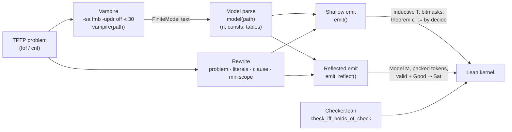

## 3. Method: Find, Rewrite, Compile, Certify

`cm.py` turns a TPTP problem (`fof` or `cnf`) into a Lean 4 proof that a finite structure satisfies `axioms ∧ ¬conjecture`. An untrusted search finds the structure; a Python translation states the claim; Lean's kernel checks it.

### 3.1 Pipeline



```
 TPTP problem ──► vampire(path) ──► model(path) ──► (n, consts, tables) ─┐
      │            -sa fmb -updr off                                     │
      │            -t 30, $CM_CACHE                                      │
      │                                                                  ▼
      └──────► problem(path) ──► [(role, formula)] ──┬──► emit()         ── shallow:  T, masks, cᵢ' := by decide ─┐
               literals / clause / miniscope         └──► emit_reflect() ── reflected: M, Dᵦ/Fᵦ, valid+Good⇒Sat ──┤
                                                                                       ▲                         ▼
                                                                       Checker.lean ───┘                   Lean kernel
```

### 3.2 Find: `vampire(path)`

`vampire` runs `$VAMPIRE` (default `vampire`) with `-sa fmb -updr off -t 30`: the finite-model-building saturation algorithm, a 30 s limit, and unused-predicate-definition removal disabled. Without `-updr off`, Vampire may settle a problem by deleting unused predicates and print no model.

If `$CM_CACHE` is set, the output is stored under `sha256(problem bytes ‖ flags ‖ vampire --version)`. A cache hit skips Vampire entirely, so a Lean upgrade reruns only Lean. Vampire's answer must carry an SZS status line or a termination reason. Vampire 5.1 reports a timeout as `% Termination reason: Time limit`, with exit status 1 and no SZS status, and the benchmark records it as *no model*. An answer with neither is an operational failure: `vampire` raises, nothing is cached, and the benchmark records *finder error*, never *no model*. Time and memory limits and run-dependent statuses (`Timeout`, `MemoryOut`, `ResourceOut`, `Error`, `InputError`, `OSError`) are never cached: they reflect the run, not the problem.

### 3.3 Model parse: `model(path)`

`model` returns `(n, consts, tables)`:

| Field | Source in Vampire output | Python type |
|---|---|---|
| `n` | count of `declare_$i<k>` lines | `int` |
| `consts` | `tff(<c>_definition, axiom, c = 'fmb_$i_k')` → element `k`; `tff(<p>_definition, axiom, (~)p)` → `bool` | `{name: int \| bool}` |
| `tables` | each `(~)f('fmb_$i_…', …) (= 'fmb_$i_k')`; `= k` makes a function entry, a bare (negated) atom a predicate entry | `{symbol: {args tuple: int \| bool}}` |

Elements are numbered `1 … n` as Vampire prints them. If the output has no `FiniteModel`, `model` exits with `no finite counter-model found` and the SZS status; for a theorem this is the correct outcome (`test_a_theorem_has_no_counter_model`).

**Reading records: `statements(path)`.** Before any formula is translated, `statements` reads the whole file and must account for every character: each is whitespace, part of a `%` comment, or part of a complete `fof` or `cnf` record `kind(name, role, formula[, annotations]).`. It walks the text once, respecting quoted tokens (whose `%`, commas and parentheses are not syntax), comments between any two tokens, and nesting depth. It splits each record at its top-level commas, so annotations are never read as part of the formula. A name must be a lower-case word, a single-quoted word (which may contain punctuation, as in `'thm.bool.TRUTH'`) or an integer. The role must be one that asserts a formula: `axiom`, `hypothesis`, `definition`, `assumption`, `lemma`, `theorem`, `corollary`, `plain`, `negated_conjecture` or `conjecture`. Anything else is rejected with its line number and no certificate is produced: another statement kind (`tff`, `include`, …), a malformed or unterminated record, an unknown role, or a `/* */` comment. `problem` and `ablate.py` both read records only through `statements`.

This replaced a regular expression that *searched* for records rather than *reading* the file. A record it could not match was skipped without error: a quoted name containing punctuation, or a comment or whitespace between `fof` and `(`. The round-4 review found this with two contradictory two-record files, each of which lost its first axiom. In the benchmark it dropped records from 9 inputs (§6.2.2).

Lexing within formulas is shared by every stage: `TOKENS` treats a quoted name `'…'` (including escaped quotes and `%`) as one token, and `uncomment` strips `%` comments only outside quoted names.

### 3.4 Rewrite: `problem`, `literals`, `clause`, `miniscope`

`decide` and the reflected evaluator both evaluate bounded `∀` and `∨` lazily. A clause with *v* variables over *n* elements has *nᵛ* cases unless a false literal prunes its subtree. The rewrite moves each quantifier as close as possible to the first literal that uses its variable.

`problem(path)` returns `[(role, formula)]`, one entry per record that `statements` read. For each it calls `literals(f, cnf)`, which calls `clause(tokens, scope)` to flatten the formula into `(scope, disjuncts)`. The result is rewritten by `miniscope(scope, lits)` when the formula is `cnf`, or when it is `fof`, has a non-empty scope, and flattens into more than one literal. Every other formula is kept verbatim.

**`clause` rules** (applied recursively, on tokens; `unwrap` drops enclosing parentheses, `split` splits at a top-level operator):

| Input shape | Output | Condition | Equivalence used |
|---|---|---|---|
| `! [X̄] : B` | `clause(B, scope ∪ X̄)` | `B` contains no top-level binary operator, and `X̄ ∩ scope = ∅` | ∀X̄ B is ∀X̄ B; the variables become part of the clause's universal prefix |
| `A₁ & … & Aₖ => B` | `[¬A₁, …, ¬Aₖ] ++ clause(B)` | top-level `=>` | A → (B → C) ↔ (A ∧ B) → C ↔ ¬A ∨ ¬B ∨ C |
| `D₁ \| … \| Dₖ` | `clause(D₁) ++ … ++ clause(Dₖ)` | top-level `\|` | associativity of ∨ |
| anything else | one literal | — | — |

Two side conditions carry the soundness of the flattening.

1. **TPTP binding.** In TPTP, `! [X] : A => B` parses as `(∀X A) → B`: the quantifier binds only the unit that follows it. `clause` pulls `∀` out only when its body `B` is a single unit (`whole`: no top-level `&`, `|`, `=>`, `<=>`). An earlier version read `! [X] : A => B` as ∀X (A → B); on three TPTP problems the altered formula still held, and Lean certified a different statement (README §5). The regression is covered by `examples/quantifier_scope.p`.
2. **Fresh variables only.** A quantifier is pulled into the clause's prefix only if none of its variables is already in `scope`. Pulling a re-bound `X` out would capture occurrences of an outer `X`. When the condition fails, the subformula stays one literal with its own quantifier.

Pulling `∀X̄` out of a disjunct is sound because, under the freshness condition, `X̄` does not occur in the other disjuncts: A ∨ ∀X B ↔ ∀X (A ∨ B) for X ∉ FV(A).

For `cnf`, `literals` starts with `scope = VARS(f)`: the clause's free variables are implicitly universal. `VARS` collects `[A-Z]\w*` identifiers after deleting quoted names, so `'X'` is never a variable.

**`miniscope(scope, lits, bound)`** rebuilds the clause as nested quantified disjunctions:

```
miniscope(scope, lits, bound):
    lit  := argmin over lits of |(VARS(l) ∩ scope) \ bound|      -- greedy: fewest new variables first
    body := lit                         if lits = [lit]
            (lit | miniscope(scope, lits \ lit, bound ∪ new(lit)))   otherwise
    return ![new(lit)]: body  if new(lit) ≠ ∅  else body
```

Each variable is bound immediately before the first literal that uses it, via ∀X (A ∨ B) ↔ A ∨ ∀X B when X ∉ FV(A). The greedy order chooses the literal that introduces the fewest new variables. That can favour a useful guard, so lazy evaluation prunes early, but it does not estimate selectivity, which depends on the model's data (§5.2). Each literal is parenthesized by `literals`, because `![Z]: A <=> B` would otherwise bind only `A`.

### 3.5 Compile (shallow): `emit`

`emit(path, n, consts, tables)` produces a self-contained Lean file:

| Model part | Lean form |
|---|---|
| Universe | `inductive T \| e1 \| … \| en deriving DecidableEq`, `T.all`, `T.mem`, `T.idx`, and `Decidable (∀ x, p x)` / `Decidable (∃ x, p x)` instances via `decidable_of_iff` over `T.all` |
| Constant `c` | `abbrev «c» : T := T.ek` |
| Propositional symbol `p` | `abbrev «p» : Prop := True \| False` |
| Predicate `p` of arity *k* | `abbrev «p» (x0 … x(k-1) : T) : Prop := (MASK >>> (1 * x0.idx + n * x1.idx + …)) % 2 = 1` |
| Function `f` | `def «f» : T → … → T` by a pattern-matching table |
| Formula *i* (from `lean(f)`) | `theorem c<i>' : <φᵢ> := by decide`; a conjecture is emitted as `¬φ` |
| Whole claim | `theorem countermodel : Nonempty T ∧ <tree of ∧> := ⟨⟨T.e1⟩, <tree of ⟨_, _⟩>⟩` |

**Nonemptiness.** A Lean inductive type with no constructors is empty, and `∀ x : T, False` holds over it, although no first-order structure satisfies it. So the domain's nonemptiness is part of the certified statement: `Nonempty T`, proved by `⟨T.e1⟩` and checked by the kernel like every other conjunct. `emit` also refuses a model of size 0 before writing anything (`test_shallow_certificate_proves_a_nonempty_domain`).

`tree(xs, pair)` builds balanced conjunctions and anonymous-constructor proofs: depth log₂ *m* instead of *m*, since a chain of 10,000 `∧` overflows the kernel. One theorem per formula gives each `decide` fresh caches.

Every generated file starts with `set_option autoImplicit false`: an unbound name is an elaboration error, never a silently added implicit argument. `sym(k)` writes a TPTP symbol as `«k»` if it matches `[a-z]\w*`, and as `«'k'»` otherwise. Quoted names keep their quotes, so a constant `'X'` becomes `«'X'»` and cannot be captured by a bound variable `X`, and `'T'` cannot collide with the type `T` (`examples/quoted_capture.p`, `examples/quoted_names.p`). The emitter's own helper declarations carry a prime (`c0'`, `P0'`, `C0'`, `chunk0'`), which no TPTP lower-case word contains, and quoted names are emitted inside their quotes, so no source symbol can collide with them; a source symbol named `countermodel`, the one unprimed public name, is emitted quoted (`'countermodel'` is the same TPTP symbol). Peer review found the collision: a source constant `c0` clashed with the helper theorem `c0` (`test_source_symbols_cannot_collide_with_generated_names`).

**Modular output.** If the problem has more than `CM_CHUNK` formulas (default 2000), `emit` returns a dict of modules instead of one string:

| Module | Contents |
|---|---|
| `Base` | options, `T`, instances, predicate and function tables |
| `Names<k>` | constant `abbrev`s, `CM_CHUNK × 5` (10,000 by default) per module |
| `Chunk<j>` | `def P<i>' : Prop := φᵢ`, `theorem c<i>' : P<i>' := by unfold P<i>'; decide`, `def C<j>'` (balanced ∧ of its `P<i>'`), `theorem chunk<j>' : C<j>'` |
| `Main` | `theorem countermodel : Nonempty T ∧ <tree of C<j>'>` |

Constants live in separate `Names` modules because Lean 4.13 fails with "deep recursion" on files with more than about 20,000 declarations (comment in `emit`). No module restates the whole problem, and `lake` checks chunks in parallel.

### 3.6 Compile (reflected): `emit_reflect`

`emit_reflect(path, n, consts, tables)` does not state formulas as Lean propositions. It writes the model as a `CM.Model` with packed tables, writes the problem as packed natural numbers, and proves each block with one `decide +kernel` call through the verified evaluator in `Checker.lean` (§4).

- `tokens(f, ids)` translates a formula into the prefix token stream read by `CM.decode`. Variables become de Bruijn indices (`env.index(k)`, last-bound variable at index 0). Symbols become numbers via `ids = {"pred", "fn", "const"}`, assigned in sorted name order; propositional symbols are numbered after the table predicates, as 0-ary predicates. A conjecture is prefixed with opcode `4` (¬).
- `as_fact(toks)` recognizes ground literals `(¬)p(c₁, …, cₖ)` over constants and returns `(polarity, predicate, [constant ids])`. Facts go into fixed-width fact tables (`F<j>`, 128 per block, proved by `holds_facts`); all other formulas go into token blocks (`D<b>`, about 4096 tokens per block, proved by `holds_of_check`).
- Lookups in the generated `M`: predicates are one packed mask per symbol, read by `get (get MASKS p mw) (index n args) 1 == 1`; constants are packed 4096 per block, the block chosen by `bsearch`, a balanced tree of `if c / 4096 < k` comparisons; functions are selected by `bsearch` over function ids, then read with `get … (index n args) w`.
- The certificate proves `valid : M.valid fns = true` and `good : Good M fns problem` (well-formedness and truth, a balanced tree of `good_append` over the blocks), and states `theorem countermodel : ∀ φ ∈ problem, φ.Sat (M.toStructure …) ⟨0, …⟩ []`: ordinary first-order satisfaction (§4.4). Above 32 blocks (`per_part`) the output is split into `Base`, `Part<k>` and `Main` modules.

`bench.py`'s `run_hybrid` chooses reflection when the share of ground-literal formulas (`fact_share`) is at least 0.9, and the shallow path otherwise.

### 3.7 Certify

The kernel checks every `decide` (shallow) or `decide +kernel` (reflected) proof. `native_decide` is never emitted by `cm.py`; `bench.py` tries it only as a fallback after a shallow `decide` timeout and reports such problems separately as `certified (native)`.

### 3.8 Trust boundary

| Stage | Code | Trusted? | Why / how it is checked |
|---|---|---|---|
| Input preprocessing (benchmark only) | `bench.expand`, `bench/inputs.py` | **Yes** | Inlines plain `include('Axioms/…')` directives so `cm.py` reads one self-contained file. Includes inside comments or quoted names are left alone; selective, nested, unresolved and non-`Axioms/` includes are refused (`test_include_expansion`). Every benchmark input is rebuilt from the official TPTP v9.3.1 release, and its original and expanded SHA-256s are checked against `bench/inputs.json` (`test_benchmark_inputs_match_their_sources`). |
| Find | Vampire | **No** | A wrong model makes `decide` fail. Mutation tests confirm that Lean rejects broken models. |
| Cache | `vampire()`, `$CM_CACHE` | **No** | It returns Vampire's output for an identical problem, flag set and version; the output is untrusted anyway. |
| Model parse | `model()` | **No**, for reflected certificates | A misparse that leaves the domain is caught: `Model.valid` (non-empty domain, functions closed) and `Fm.wf` (constants in range, bound variables, checked arities) are kernel-checked parts of every reflected certificate. A misparse that stays in the domain yields a different structure. Lean then certifies that structure if, and only if, it satisfies the formulas. For shallow certificates, constants and function values are constructors of `T`, so they lie in the domain by construction, and nonemptiness is a kernel-checked conjunct of the statement (`Nonempty T`, §3.5). |
| Record reading | `statements` | **Yes** | Which formulas exist. It must account for every character of the file or reject it, so a record cannot be dropped silently (§3.3). Tested against the oracle's separately written record reader and against hand-counted fixtures (`test_every_record_is_accounted_for`, `test_unreadable_records_are_rejected_not_skipped`); the round-4 regressions run a model of part of a problem through both certificate paths, which Lean must reject (`test_a_model_of_part_of_the_problem_is_rejected`). |
| Rewrite | `problem`, `clause`, `literals`, `miniscope` | **Yes** | A non-equivalent rewrite changes what is certified. Tested by `test_rewriting_preserves_meaning` and regression examples. |
| Translation (shallow) | `lean()`, `sym()`, `emit()` | **Yes** | The Lean statement must mean the TPTP formula. Tested by the independent evaluator and by mutant agreement; the statement is readable in the `.lean` file. |
| Translation (reflected) | `tokens()`, `as_fact()`, symbol numbering | **Yes** | The `Fm` data must mean the TPTP formula. Tested by `test_reflected_mutants_agree_with_python` against an evaluator of the *original* formulas; `#eval problem` is a diagnostic that prints the decoded data (with numeric symbol ids), not a fidelity proof. |
| Evaluator and semantics | `Checker.lean` (`Fm.check`, `decode`, `fact`, `Model.valid`, `Fm.wf`) | **No** (proved) | `check_iff` (evaluator = bounded semantics) and `sem_iff_sat` (bounded semantics = ordinary satisfaction, for valid models and well-formed formulas) are kernel-checked theorems; `countermodel_of_good` combines them. |
| Certify | Lean kernel | **Yes** | Axioms: `propext` (shallow); `propext`, `Quot.sound` (reflected, per `bench/nlp263-reflected-lean4.35.json`). |

### 3.9 Worked example: `transitive_cnf`

Input (`examples/transitive_cnf.p`):

```
cnf(transitive, axiom, ~ r(X,Y) | ~ r(Y,Z) | r(X,Z)).
cnf(a_before_b, axiom, r(a,b)).
cnf(not_symmetric, negated_conjecture, ~ r(b,a)).
```

`problem` rewrites the first clause. `scope = {X, Y, Z}`; all three literals introduce two new variables, so `min` takes the first, `~r(X,Y)`, binding `X, Y`; then `~r(Y,Z)` introduces only `Z`:

```
![X,Y]: ((~ r ( X , Y )) | ![Z]: ((~ r ( Y , Z )) | (r ( X , Z ))))
```

Vampire returns a 2-element model: `a = 1`, `b = 2`, and `r` true only at `(1, 2)`. `emit` encodes `r` as mask `4 = 2^(0 + 2·1)`, bit index `x0.idx + 2·x1.idx`. Generated `Cm/transitive_cnf.lean` (excerpt):

```lean
inductive T | e1 | e2
  deriving DecidableEq
...
abbrev «a» : T := T.e1
abbrev «b» : T := T.e2
abbrev «r» (x0 x1 : T) : Prop := (4 >>> (1 * x0.idx + 2 * x1.idx)) % 2 = 1

theorem c0' : (∀ X' Y' : T, (¬(«r» X' Y') ∨ (∀ Z' : T, (¬(«r» Y' Z') ∨ («r» X' Z'))))) := by decide
theorem c1' : («r» «a» «b») := by decide
theorem c2' : ¬(«r» «b» «a») := by decide

theorem countermodel : Nonempty T ∧ (((∀ X' Y' : T, (¬(«r» X' Y') ∨ (∀ Z' : T, (¬(«r» Y' Z') ∨ («r» X' Z')))))) ∧
    (((«r» «a» «b»)) ∧ (¬(«r» «b» «a»)))) :=
  ⟨⟨T.e1⟩, ⟨c0', ⟨c1', c2'⟩⟩⟩
```

TPTP variables are emitted primed (`X` becomes `X'`). A TPTP variable cannot contain `'`, so no variable can shadow the domain type `T` or a Lean constant such as `True`.

In the reflected path, with `ids = {pred: {r: 0}, const: {a: 0, b: 1}}`, `tokens` produces:

| Formula | Tokens | Route |
|---|---|---|
| transitive | `9 9 6 4 0 0 2 0 1 0 0 9 6 4 0 0 2 0 1 0 0 0 0 2 0 2 0 0` | token block `D0` |
| `r(a,b)` | `0 0 2 1 0 1 1` → `as_fact` = `(1, 0, [0, 1])` | fact table `F0` |
| `~r(b,a)` | `4 0 0 2 1 1 1 0` → `as_fact` = `(0, 0, [1, 0])` | fact table `F0` |

Reading the first stream: `9 9` is ∀∀, `6` is ∨, `4 0 0 2 (0 1) (0 0)` is ¬r(var 1, var 0), i.e. ¬r(X, Y), because `Y`, bound last, is index 0.

`group_comm.p` illustrates the other branch of `problem`: each `fof` formula there is a single equation under one `!`, so `clause` yields one literal, the `ok` test fails, and the formula is emitted unchanged, e.g. `theorem c3 : ¬(∀ X' Y' : T, ((«mul» X' Y') = («mul» Y' X'))) := by decide` over the 6-element model S₃.

### 3.10 Independent checks (`test_cm.py`)

The trusted Python stages are tested against an evaluator with its **own record reader**. It shares two small helpers with `cm.py`: the lexer that its formula evaluator uses inside a formula (`TOKENS`) and the variable collector (`VARS`). It shares no record reader, parser, rewriter or translator. Until round 4 it also shared, by copying, the regular expression that decided which records exist, so both silently skipped the same records; peer review found this (§6.2.2). Each test declares the tools it needs: without Vampire, the 61 tests that need no Vampire model still run (record reading, rejection, preprocessing, nonemptiness, input integrity, name collisions, rewrite equivalence on small structures and the kernel boundary cases); with Vampire 5.1 and Lean 4.35, all 149 run.

| Test | What it checks |
|---|---|
| `holds(s, n, consts, tables, env)` | Not a test: a brute-force evaluator of the **original** TPTP text. It parses with its own recursive descent and evaluates `!`/`?` with `itertools.product` over `1 … n`. It never sees `lean()`, `tokens()` or `Checker.lean`. |
| `records(text)`, `raw(path)` | The oracle's reader of source records: a separate lexer (`ORACLE_LEX`) and a token-level matcher for `kind(name, role, formula[, annotations]).`, which must consume every token of the file. `raw` returns each record's role and formula, with each `cnf` clause closed by `![VARS]`. It never calls `statements()` or `problem()`, so none of `cm.py`'s record reading or rewriting reaches the oracle. |
| `countermodel(path, …)` | Python's verdict on `raw(path)`: every original formula holds under `holds`, except the conjecture, which fails. Both mutant tests compare Lean against this verdict. |
| `test_compiles_to_committed_file`, `test_reflects_to_committed_file` | `cm.py` output equals the committed `Cm/<name>.lean` (shallow) and `Refl/<name>.lean` (reflected), for each of the 15 `examples/*.p`. |
| `test_kernel_accepts_with_propext_only` | `lake build` succeeds and every line of `#print axioms` (via `Axioms.lean`) ends with `[propext]`. |
| `test_python_agrees_it_is_a_countermodel` | `holds` confirms Vampire's model for every example. |
| `test_circle_of_fifths_is_the_known_answer` | The model has exactly 12 elements, and `f` and `g` are x ↦ x+7 and x ↦ x+5 (mod 12). |
| `test_mutants_lean_and_python_agree` | Two random one-entry corruptions per example (seed 0): Lean (shallow) accepts **exactly** the mutants that `holds` accepts, and at least one mutant is rejected. |
| `test_reflected_mutants_agree_with_python` | Same, seed 1, through `emit_reflect` and `Checker.lean`. This tests the reflected translation, the trusted part of that path. |
| `test_reflected_certificate` | Each example's model certifies through `emit_reflect`. |
| `test_rewriting_preserves_meaning` | Each rewritten formula agrees with its raw original (a `cnf` closed with `![VARS]`) under `holds`, on the model and on every one-entry mutation of every table. |
| `test_a_theorem_has_no_counter_model` | `cm.py` exits non-zero on `∀X p(X) ⊢ p(k)`. |
| `test_large_problems_split_into_modules`, `test_constants_split_into_name_modules` | With `CM_CHUNK=2` or `1`, modular output builds with `lake`; `#print axioms` on the result contains no `sorryAx`. |
| `test_vampire_cache_is_transparent` | With `CM_CACHE`, the second run hits the cache (one entry) and emits identical Lean. |
| `test_boundary_cases_are_rejected_by_the_kernel` | Builds `tests/Boundary.lean`: the reviewer's out-of-range constant passes `check` but fails `wf`; an empty domain and a leaking function fail `valid`; an unbound variable and a wrong arity fail `wf`; too little decoder fuel yields ⊥ (documented behaviour, not general truncation detection). |
| `test_quoted_and_plain_names_are_the_same_symbol` | `cat` and `'cat'` translate identically; `'X'` stays a constant, distinct from the variable `X`. |
| `test_unsupported_syntax_is_rejected_not_misread` (7 cases), `test_typed_statements_and_includes_are_rejected` (2), `test_a_symbol_at_two_arities_is_rejected` | Fail-closed parsing: `<~>`, `<=`, `~\|`, `~&`, `$distinct`, numbers, strings, `tff`, `include` and mixed arities raise an error in both translators. |
| `test_benchmark_records_unsupported_input` | The harness classifies such inputs as *unsupported input* **before** Vampire runs (the test supplies a Vampire binary that does not exist). |
| `test_variables_cannot_capture_lean_names` (5 cases) | Variables named `T`, `True`, `False`, `Nat`, `Decidable` compile; `T` and `True` failed on the translator before the fix. |
| `test_include_expansion` | `bench.expand` inlines a plain include (with or without TPTP's optional spaces); leaves includes in `%` and `/* */` comments and inside quoted names untouched; leaves a selective include in place, which `problem()` then refuses; and raises on unresolved, nested and non-`Axioms/` includes. |
| `test_block_comments_are_rejected` | A `/* … */` comment, which `cm.py` does not strip, is refused rather than read as formulas; `'/*'` inside a quoted name is just a name. |
| `test_shallow_certificate_proves_a_nonempty_domain` | `emit` refuses a 0-element model, and every committed shallow certificate states `Nonempty T ∧ …`. |
| `test_benchmark_inputs_match_their_sources` | Every benchmark input equals `bench.expand` applied to its TPTP original, byte for byte, and originals, expansions and axiom files match the SHA-256s in `bench/inputs.json`. Skipped if the inputs have not been rebuilt (`bench/inputs.py`). |
| `test_every_record_is_accounted_for` (7 cases), `test_annotations_are_not_formulas` | Hand-counted files: the reviewer's two contradictory files (2 records each), spaced and commented record syntax, annotations, integer and punctuated quoted names (`'thm.bool.TRUTH'`, `'it\'s'`), a `%` inside a name, and a comment hiding a fake record. `statements`, the oracle's `records` and `problem` must each find exactly the hand count. |
| `test_unreadable_records_are_rejected_not_skipped` (9 cases) | Stray text, a record without a formula, an unknown role, `tff`, `include`, a missing `.`, unbalanced parentheses, a `/* */` comment and a two-word name: both readers refuse the whole file. |
| `test_a_model_of_part_of_the_problem_is_rejected` (2 cases) | The round-4 reviewer's protocol: for each contradictory file, a one-element model of only `~p(a)`. The oracle rejects it, and Lean rejects both the shallow and the reflected certificate. |
| `test_source_symbols_cannot_collide_with_generated_names` | Symbols named `c0`, `p0`, `chunk0` and `countermodel` certify on both paths. |
| `test_a_failing_finder_is_not_a_search_outcome`, `test_benchmark_reports_a_failing_finder_as_finder_error` | A finder that prints no SZS status or termination reason and exits non-zero: `cm.py` reports *vampire failed*, the benchmark records *finder error*, and nothing is cached. |
| `test_a_timeout_is_a_search_outcome_not_a_failure` | Vampire 5.1's timeout output (`Termination reason: Time limit`, exit 1, no SZS status): the benchmark records *no model*, and nothing is cached. |
| `test_rewriting_is_equivalent_on_every_small_structure` (18 cases) | Adversarial forms for the rewrite (independent variables, a shadowed variable, ∀ moved across ∨, implication flattening, vacuous quantification, ∃ under ∀, equality, negated conjunction, an equivalence, transitivity clauses): original and rewritten formulas agree on every interpretation of constants `a`, `b`, unary `p`, `q` and binary `r` over domains of size 1 and 2 (8 + 1,024 structures each). Exhaustive within that finite space, not a proof. |
| `test_clause_search_agrees_with_brute_force` | `clause_holds`, an independent evaluator of `cnf` clauses that searches for a falsifying assignment, agrees with `holds` on six clauses over the same 1,032 structures (each clause is false on 192 to 578 of them). |
| `test_fidelity_check_flags_a_model_of_part_of_the_problem` | `bench/fidelity.py` reports NOT FAITHFUL for the round-4 reviewer's wrong model, because it reads the whole original file. |
| `test_ablation_finds_what_a_conclusion_needs` | `ablate.py` labels a needed axiom with a certified counter-model, and never labels an underivable target as needing anything. |

The suite has **149 test cases**: 5 tests parametrized over the 15 examples (75), 14 rejection and capture cases, 18 record-reading cases, 18 adversarial rewrite cases, and 24 single tests. Separately, `recheck.sh` rebuilds all 30 shipped certificates, prints their axioms and replays `Checker`, `AllShallow` and `AllReflected` through the kernel from scratch with `leanchecker --fresh` (Lean 4.35); its output is `bench/recheck.log`. The benchmark certificates are replayed the same way by `bench/replay.py` (§6.2).

**Planted bugs.** The suite was validated by introducing known bugs into `cm.py` and confirming failures (README §5): `=>` compiled as `↔` (7 tests fail), a scoping bug (4), a dropped negation (18), a lost parenthesis (4), and the single-formula case (1). The planted variants are not in the repository; the counts are those recorded in the README, measured against the suite at that time.
